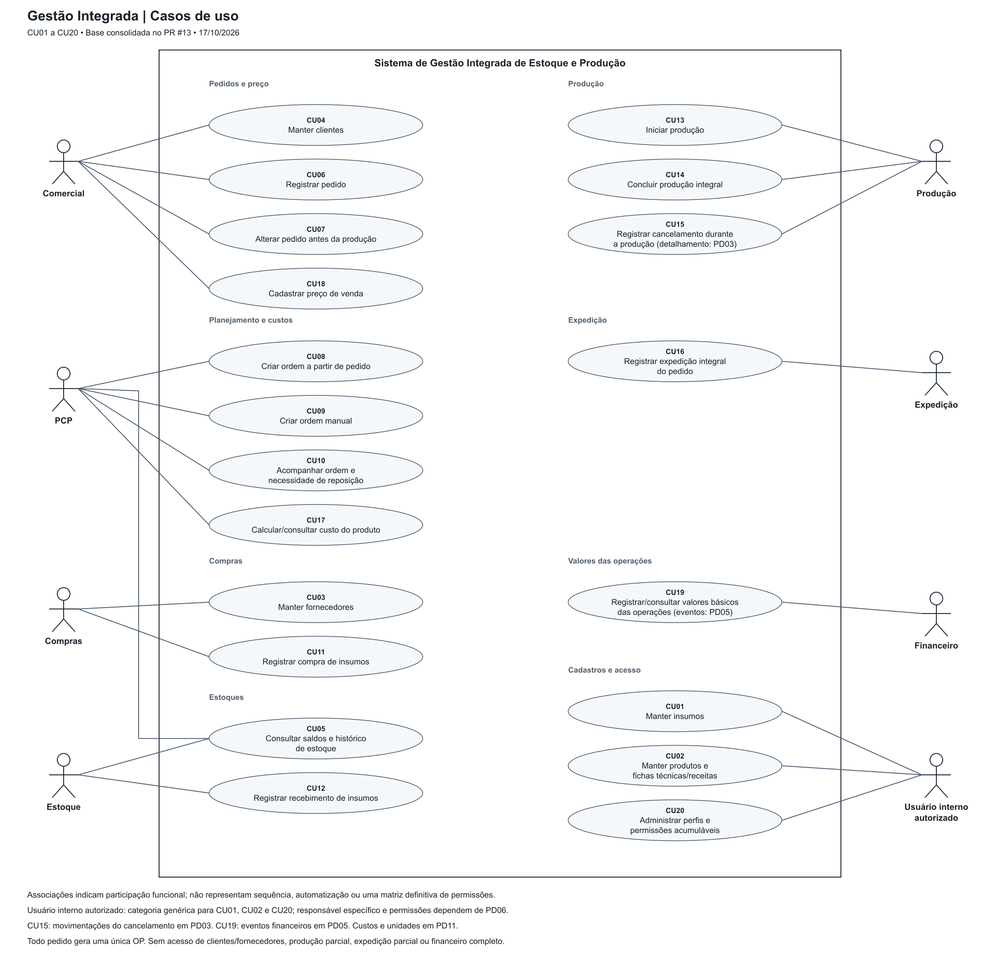

# Diagrama de Casos de Uso

**Revisão:** 17/10/2026 
**Escopo:** Issue #3, derivada da base consolidada da Issue #2 e do PR #13.

- [Arquivo editável no diagrams.net/draw.io](casos-de-uso.drawio).
- [Imagem exportada](casos-de-uso.png).
- [Catálogo de atores, casos de uso e fluxos principais](../../02-requisitos/atores-casos-de-uso-regras-de-negocio.md).
- [Requisitos, regras de negócio e pendências](../../02-requisitos/escopo-e-requisitos.md).

## Notação e fronteira

O retângulo representa o sistema. Os atores ficam fora dele e as elipses representam objetivos de uso, identificados pelos mesmos CU01 a CU20 do catálogo. Linhas contínuas sem setas são associações entre ator e caso de uso; não são um fluxo de execução.

Comercial, PCP, Compras, Estoque, Produção, Expedição e Financeiro representam papéis funcionais acumuláveis por uma mesma pessoa. Clientes e fornecedores são entidades cadastradas, sem acesso e sem associação como atores externos.

**Usuário interno autorizado** é a categoria genérica utilizada nos cadastros de insumos, produtos/receitas e na administração de acessos, cujos responsáveis específicos ainda dependem de PD06. Não se cria um novo perfil nem se concede acesso irrestrito a qualquer usuário.

Não foram incluídas relações `include` ou `extend`. Consultar receitas, calcular necessidades, verificar disponibilidade e registrar movimentações são passos internos dos casos existentes. A obrigatoriedade de criar uma OP para todo pedido é uma regra de negócio (RN10), não uma relação de inclusão entre o registro do pedido e a criação da OP: são ações separadas de Comercial e PCP.

## Cobertura e rastreabilidade

| Casos de uso | Participação de referência | Requisitos |
|---|---|---|
| CU01, CU02 | Usuário interno autorizado; responsável específico em PD06 | RF01, RF02, RF03 |
| CU03 | Compras | RF04 |
| CU04, CU06, CU07, CU18 | Comercial | RF05, RF12, RF25, RF31 |
| CU05 | Estoque e PCP | RF06, RF07, RF08 |
| CU08, CU09, CU10 | PCP | RF11, RF13, RF14, RF15, RF16, RF17, RF18, RF26 |
| CU11 | Compras | RF09, RF24 |
| CU12 | Estoque | RF10, RF27 |
| CU13, CU14 | Produção | RF17, RF18, RF19, RF20, RF27, RF28 |
| CU15 | Produção; autorização e movimentações em PD03/PD06 | RF29 |
| CU16 | Expedição | RF21, RF22 |
| CU17 | PCP; demais acessos e preços/unidades em PD06/PD11 | RF30 |
| CU19 | Financeiro; eventos em PD05 | RF23, RF24, RF33 |
| CU20 | Usuário interno autorizado; administração específica em PD06 | RF32 |

Os fluxos principais estão no catálogo funcional: pedido/alteração; ordens por pedido e manuais; compra/recebimento; início/conclusão integral; expedição; custos/preços/valores. Demais cadastros, consultas e acesso têm descrição funcional na mesma seção, com os limites ainda pendentes explicitados.

## Verificação contra a base consolidada

- Todo pedido exige uma única OP, mesmo com estoque acabado suficiente; a OP pode conter vários produtos e também pode ser criada manualmente.
- Compra registrada e recebimento são interações distintas; a entrada de insumos acontece no recebimento.
- A ordem aguarda reposição com faltas e só inicia com todos os insumos necessários disponíveis.
- Conclusão integral registra consumo de insumos e entrada de produtos acabados.
- Expedição integral é vinculada ao pedido e gera saída do estoque acabado; não é criada como consequência automática de uma OP manual.
- Custos usam receita e último preço de compra; preço de venda é manual; valores financeiros não representam pagamentos bancários.
- Não são introduzidos validade/FEFO, acessos de parceiros, aprovações de compra ou atendimento parcial.

## Critérios da Issue #3

| Critério | Evidência |
|---|---|
| Criar diagrama de casos de uso | Imagem e arquivo editável desta pasta, com CU01 a CU20. |
| Descrever fluxos principais | Seção 3 do catálogo de atores e casos de uso. |
| Consistência com requisitos | Tabela de rastreabilidade acima e RN01 a RN25 do escopo. |
| Disponibilizar editável e imagem | `casos-de-uso.drawio` e `casos-de-uso.png`. |

O diagrama é uma modelagem funcional. Seu fornecimento não resolve as pendências PD nem substitui classes, DER, estados, sequência ou arquitetura das issues seguintes.
