# Casos de uso da reposição estatística

Revisão: **20/11/2026**. Extensão funcional planejada para o TCC II. Complementa o [diagrama geral CU01–CU20](README.md) com CU21/CU22, sem alterar atores ou implementar permissões. Usuário interno autorizado é a categoria já usada na base; PCP é a referência da função, com concessão definitiva em PD06.

[Fonte editável](reposicao.mmd). As elipses representam objetivos do usuário; linhas sem setas indicam associação, não fluxo. Preparo de histórico e execução da fórmula são passos internos de CU22. O retângulo delimita a extensão do sistema.

Os fluxos, pré-condições, resultados e RF37–RF42 estão no [complemento funcional](../../02-requisitos/reposicao-estatistica.md). A [matriz](../../06-testes/matriz-rastreabilidade.md) relaciona esses casos com cenários, dados e componentes. Clientes e fornecedores continuam sem acesso.
