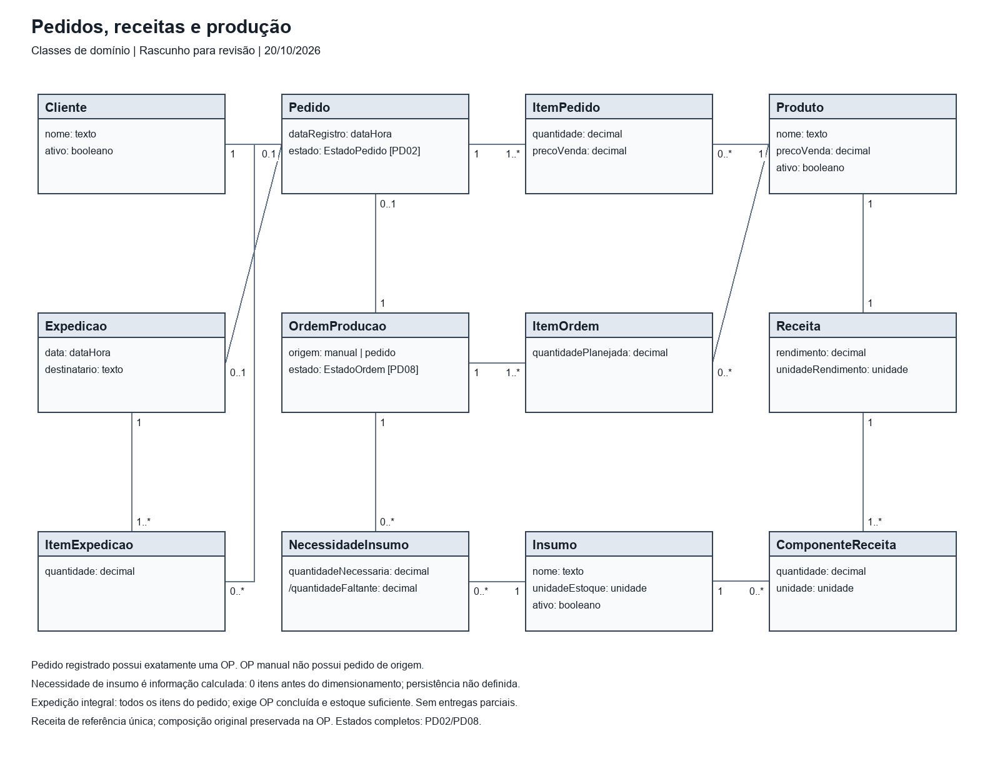
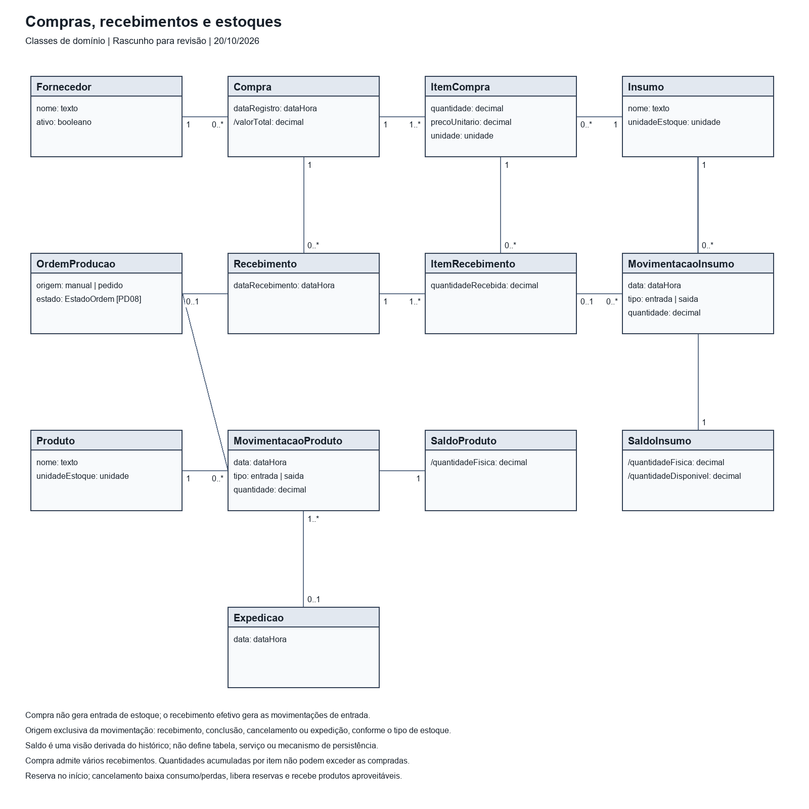
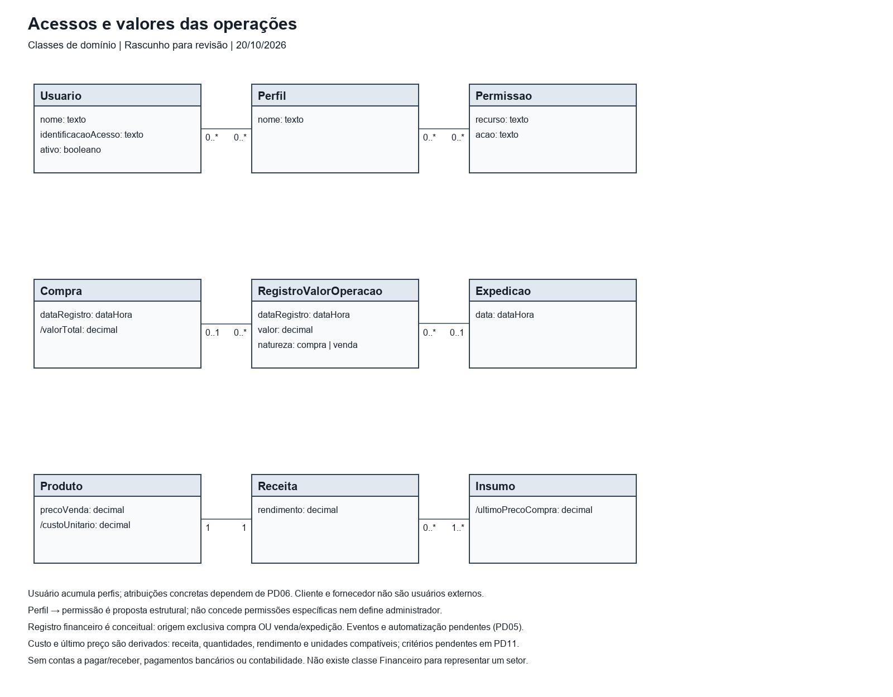
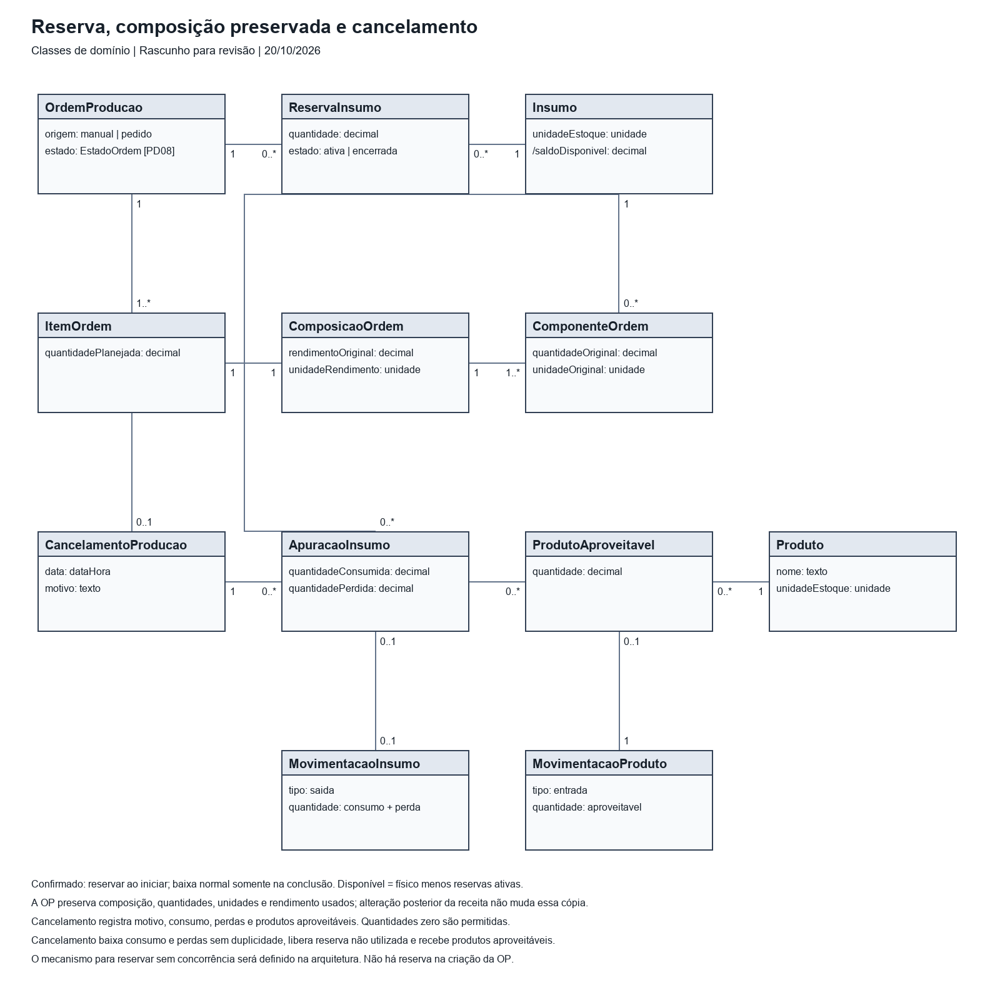

# Diagrama de classes de domínio

**Status:** rascunho para revisão na branch `docs/diagrama-classes-dominio`.

Base: RF01–RF33, RN01–RN25 e catálogo de casos de uso na main. Atributos são uma proposta mínima de análise, não um esquema de banco nem lista definitiva de dados obrigatórios. `/` indica informação derivada. Não foram incluídos métodos de infraestrutura, tabelas de junção ou controladores.

[Arquivo editável com as quatro vistas](classes-dominio.drawio).

## Pedidos, receitas e produção

| Classe A | Multiplicidade junto a A | Relação | Multiplicidade junto a B | Classe B |
|---|---|---|---|---|
| Cliente | 1 | recebe | 0..* | Pedido |
| Pedido | 1 | compõe | 1..* | ItemPedido |
| ItemPedido | 0..* | refere-se | 1 | Produto |
| Pedido | 0..1 | gera automaticamente | 1 | OrdemProducao |
| OrdemProducao | 1 | compõe | 1..* | ItemOrdem |
| ItemOrdem | 0..* | produz | 1 | Produto |
| Produto | 1 | receita de referência | 1 | Receita |
| Receita | 1 | compõe | 1..* | ComponenteReceita |
| ComponenteReceita | 0..* | utiliza | 1 | Insumo |
| OrdemProducao | 1 | calcula | 0..* | NecessidadeInsumo |
| NecessidadeInsumo | 0..* | totaliza | 1 | Insumo |
| Pedido | 1 | atendido por | 0..1 | Expedicao |
| Expedicao | 1 | compõe | 1..* | ItemExpedicao |
| ItemExpedicao | 0..* | expede | 1 | Produto |

- Pedido registrado possui exatamente uma OP. OP manual não possui pedido de origem.
- Necessidade de insumo é informação calculada: 0 itens antes do dimensionamento; persistência não definida.
- Expedição integral: todos os itens do pedido; exige OP concluída e estoque suficiente. Sem entregas parciais.
- Receita de referência única; composição original preservada na OP. Estados completos: PD02/PD08.

## Compras, recebimentos e estoques

| Classe A | Multiplicidade junto a A | Relação | Multiplicidade junto a B | Classe B |
|---|---|---|---|---|
| Fornecedor | 1 | fornece | 0..* | Compra |
| Compra | 1 | compõe | 1..* | ItemCompra |
| ItemCompra | 0..* | adquire | 1 | Insumo |
| Compra | 1 | recebimentos parciais | 0..* | Recebimento |
| Recebimento | 1 | compõe | 1..* | ItemRecebimento |
| ItemRecebimento | 0..* | confere item | 1 | ItemCompra |
| ItemRecebimento | 0..1 | gera entrada | 1 | MovimentacaoInsumo |
| MovimentacaoInsumo | 0..* | movimenta | 1 | Insumo |
| Insumo | 1 | saldo agregado | 1 | SaldoInsumo |
| OrdemProducao | 0..1 | gera consumo na conclusão | 0..* | MovimentacaoInsumo |
| OrdemProducao | 0..1 | gera entrada na conclusão | 0..* | MovimentacaoProduto |
| Produto | 1 | movimentações | 0..* | MovimentacaoProduto |
| Produto | 1 | saldo agregado | 1 | SaldoProduto |
| Expedicao | 0..1 | gera saída | 1..* | MovimentacaoProduto |

- Compra não gera entrada de estoque; o recebimento efetivo gera as movimentações de entrada.
- Origem exclusiva da movimentação: recebimento, conclusão, cancelamento ou expedição, conforme o tipo de estoque.
- Saldo é uma visão derivada do histórico; não define tabela, serviço ou mecanismo de persistência.
- Compra admite vários recebimentos. Quantidades acumuladas por item não podem exceder as compradas.
- Reserva no início; cancelamento baixa consumo/perdas, libera reservas e recebe produtos aproveitáveis.

## Acessos e valores das operações

| Classe A | Multiplicidade junto a A | Relação | Multiplicidade junto a B | Classe B |
|---|---|---|---|---|
| Usuario | 0..* | acumula | 0..* | Perfil |
| Perfil | 0..* | concede [PD06] | 0..* | Permissao |
| Compra | 0..1 | origem [PD05] | 0..* | RegistroValorOperacao |
| Expedicao | 0..1 | origem [PD05] | 0..* | RegistroValorOperacao |
| Produto | 1 | custo pela receita | 1 | Receita |
| Receita | 0..* | via ComponenteReceita | 1..* | Insumo |

- Usuário acumula perfis; atribuições concretas dependem de PD06. Cliente e fornecedor não são usuários externos.
- Perfil → permissão é proposta estrutural; não concede permissões específicas nem define administrador.
- Registro financeiro é conceitual: origem exclusiva compra OU venda/expedição. Eventos e automatização pendentes (PD05).
- Custo e último preço são derivados: receita, quantidades, rendimento e unidades compatíveis; critérios pendentes em PD11.
- Sem contas a pagar/receber, pagamentos bancários ou contabilidade. Não existe classe Financeiro para representar um setor.

## Reserva, composição preservada e cancelamento

| Classe A | Multiplicidade junto a A | Relação | Multiplicidade junto a B | Classe B |
|---|---|---|---|---|
| OrdemProducao | 1 | reserva ao iniciar | 0..* | ReservaInsumo |
| ReservaInsumo | 0..* | indisponibiliza saldo | 1 | Insumo |
| OrdemProducao | 1 | compõe | 1..* | ItemOrdem |
| ItemOrdem | 1 | preserva composição | 1 | ComposicaoOrdem |
| ComposicaoOrdem | 1 | copia componentes | 1..* | ComponenteOrdem |
| ComponenteOrdem | 0..* | referencia | 1 | Insumo |
| OrdemProducao | 1 | pode registrar | 0..1 | CancelamentoProducao |
| CancelamentoProducao | 1 | apura | 0..* | ApuracaoInsumo |
| ApuracaoInsumo | 0..* | quantifica | 1 | Insumo |
| CancelamentoProducao | 1 | apura | 0..* | ProdutoAproveitavel |
| ProdutoAproveitavel | 0..* | quantifica | 1 | Produto |
| ApuracaoInsumo | 0..1 | gera baixa se total positivo | 0..1 | MovimentacaoInsumo |
| ProdutoAproveitavel | 0..1 | gera entrada | 1 | MovimentacaoProduto |

- Confirmado: reservar ao iniciar; baixa normal somente na conclusão. Disponível = físico menos reservas ativas.
- A OP preserva composição, quantidades, unidades e rendimento usados; alteração posterior da receita não muda essa cópia.
- Cancelamento registra motivo, consumo, perdas e produtos aproveitáveis. Quantidades zero são permitidas.
- Cancelamento baixa consumo e perdas sem duplicidade, libera reserva não utilizada e recebe produtos aproveitáveis.
- O mecanismo para reservar sem concorrência será definido na arquitetura. Não há reserva na criação da OP.

## Decisões confirmadas em 20/10/2026

- Reservar insumos ao iniciar a produção; a baixa normal continua na conclusão.
- Preservar na OP a composição da receita e as quantidades originais.
- Registrar consumo, perdas e produtos aproveitáveis ao cancelar produção iniciada.

## Confirmações adicionais

- Compra aceita vários recebimentos parciais, respeitando o total de cada item.
- Cancelamento baixa consumo e perdas sem duplicidade, libera o restante reservado e recebe aproveitáveis.

Estados completos, permissões, eventos financeiros, preços e unidades continuam com suas pendências. A alteração de itens do pedido antes do início exige recalcular a OP; a política de substituir a composição preservada nessa alteração ainda deve ser detalhada.

## Rastreabilidade

| Área | Requisitos |
|---|---|
| Produtos, insumos, receitas e parceiros | RF01–RF05 |
| Saldos e movimentações | RF06–RF08, RF19–RF22 |
| Compras e recebimento | RF09–RF10, RF24, RF27 |
| Pedidos, ordens e necessidades | RF11–RF18, RF25–RF29 |
| Custos, preços e valores | RF23–RF24, RF30–RF31, RF33 |
| Usuários e perfis | RF32 |
