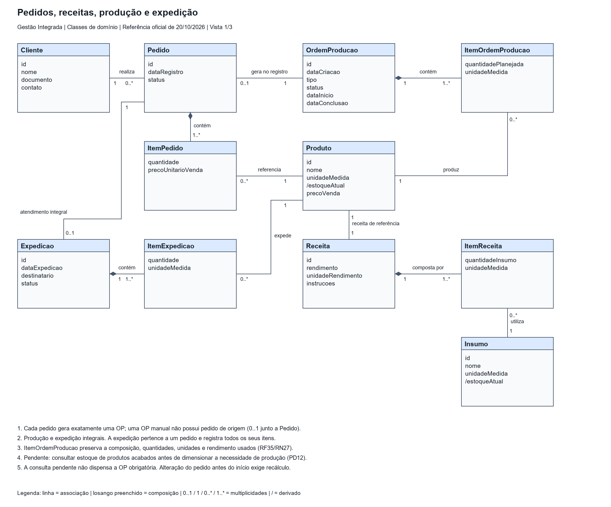
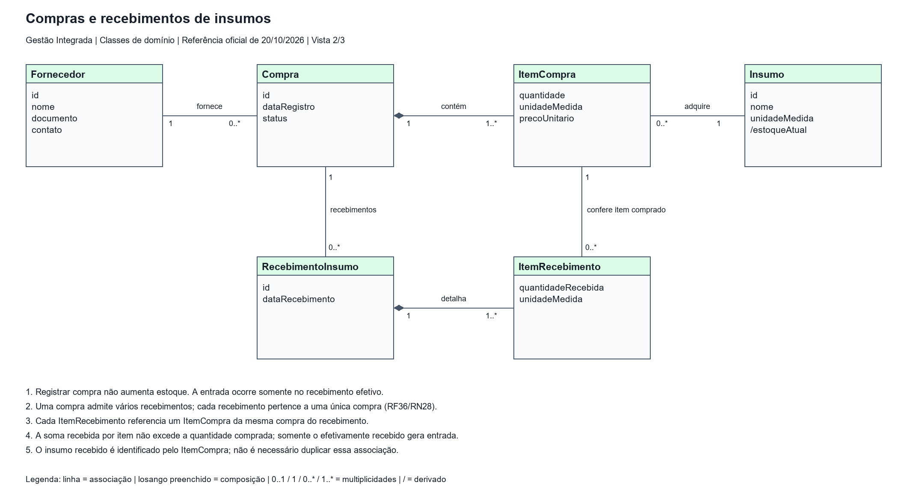
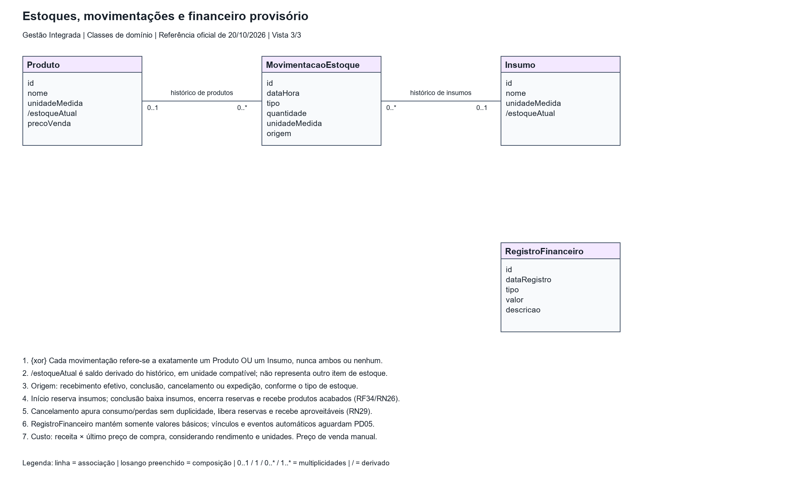

# Diagrama de classes de domínio

**Referência:** imagem oficial “WhatsApp Image 2026-10-20 at 18.04.45.jpeg”, fornecida pelo solicitante. 
**Revisão:** 24/10/2026 — issue #4. 
**Status:** versão oficial transcrita para revisão, com ajustes de consistência documentados abaixo.

[Fonte editável no diagrams.net/draw.io](classes-dominio.drawio), com três vistas complementares do mesmo modelo. Classes repetidas entre vistas representam o mesmo conceito. Atributos são de análise; não definem tabelas, tipos técnicos nem obrigatoriedade de todos os campos.

## Pedidos, receitas, produção e expedição

| Classe A | Multiplicidade junto a A | Relação | Multiplicidade junto a B | Classe B |
|---|---|---|---|---|
| Cliente | 1 | realiza | 0..* | Pedido |
| Pedido | 1 | contém (composição) | 1..* | ItemPedido |
| ItemPedido | 0..* | referencia | 1 | Produto |
| Pedido | 0..1 | gera no registro | 1 | OrdemProducao |
| OrdemProducao | 1 | contém (composição) | 1..* | ItemOrdemProducao |
| ItemOrdemProducao | 0..* | produz | 1 | Produto |
| Produto | 1 | receita de referência | 1 | Receita |
| Receita | 1 | composta por (composição) | 1..* | ItemReceita |
| ItemReceita | 0..* | utiliza | 1 | Insumo |
| Pedido | 1 | atendimento integral | 0..1 | Expedicao |
| Expedicao | 1 | contém (composição) | 1..* | ItemExpedicao |
| ItemExpedicao | 0..* | expede | 1 | Produto |

Cada pedido gera exatamente uma OP, automaticamente no registro. O `0..1` junto a Pedido permite que a OP manual não tenha pedido de origem; não torna opcional a OP do pedido. A expedição é integral e registra todos os produtos e quantidades do pedido. Produção e expedição parciais continuam fora do escopo.

Produto possui uma receita de referência com rendimento; o versionamento do cadastro permanece indefinido. Conforme RF35/RN27 já registrados na branch, cada ItemOrdemProducao preserva a composição, quantidades, unidades e rendimento usados. Isso não impõe uma estrutura técnica de armazenamento ou versionamento de receitas.

## Compras e recebimentos

| Classe A | Multiplicidade junto a A | Relação | Multiplicidade junto a B | Classe B |
|---|---|---|---|---|
| Fornecedor | 1 | fornece | 0..* | Compra |
| Compra | 1 | contém (composição) | 1..* | ItemCompra |
| ItemCompra | 0..* | adquire | 1 | Insumo |
| Compra | 1 | recebimentos | 0..* | RecebimentoInsumo |
| RecebimentoInsumo | 1 | detalha (composição) | 1..* | ItemRecebimento |
| ItemRecebimento | 0..* | confere item comprado | 1 | ItemCompra |

Compra não aumenta estoque. Somente o recebimento efetivo gera entrada. Uma compra admite vários recebimentos, conforme RF36/RN28. Cada ItemRecebimento referencia um ItemCompra da mesma compra do recebimento; o total recebido por item não excede o comprado. O insumo é identificado pelo item comprado, sem associação redundante.

## Estoques e financeiro provisório

| Classe A | Multiplicidade junto a A | Relação | Multiplicidade junto a B | Classe B |
|---|---|---|---|---|
| Produto | 0..1 | histórico de produtos | 0..* | MovimentacaoEstoque |
| Insumo | 0..1 | histórico de insumos | 0..* | MovimentacaoEstoque |

**Restrição exclusiva e obrigatória:** cada MovimentacaoEstoque referencia exatamente um Produto **ou** um Insumo, nunca ambos ou nenhum. As duas multiplicidades `0..1` são complementadas pela nota `{xor}` e por esta regra. Produto e Insumo não se relacionam entre si como “item de estoque”; não há herança presumida.

`/estoqueAtual` é saldo derivado do histórico em unidade compatível, sem definir persistência. Origens: recebimento, conclusão, cancelamento ou expedição, conforme o estoque. Iniciar reserva insumos; concluir baixa insumos, encerra reservas e recebe acabados. Cancelar apura consumo/perdas sem duplicidade, libera o restante reservado e recebe produtos aproveitáveis (RF34–RF36/RN26–RN29 já documentados na branch).

RegistroFinanceiro preserva os atributos da referência oficial e permanece provisório, sem associações ou eventos automáticos presumidos. Não representa pagamentos, contas a pagar/receber ou contabilidade. Custo usa receita e último preço de compra dos insumos, com rendimento e unidades compatíveis; preço de venda é manual. Eventos financeiros (PD05), preços e conversões (PD11) permanecem pendentes.

## Ajustes em relação à imagem oficial

| Ponto | Ajuste e fundamento |
|---|---|
| Pedido → OP | `0..1` junto a Pedido e `1` junto à OP: origem manual permitida, OP única obrigatória por pedido (RF13/RN09/RN10/RN13). |
| Itens → Produto/Insumo | Cada item referencia exatamente um produto ou insumo; um cadastro pode aparecer em vários itens. Corrigidas multiplicidades ausentes ou ambíguas. |
| Produto → Receita | Associação explícita de receita de referência com rendimento (RN01/RN02); substitui o traçado ambíguo que alcançava ItemPedido. |
| Recebimento | Cabeçalho associado à Compra e detalhes aos ItemCompra correspondentes, em lugar de ligar o cabeçalho diretamente a um item; preserva RF36/RN28. |
| Estoques | MovimentacaoEstoque única, como na imagem, com referência exclusiva a Produto ou Insumo; removida associação ambígua entre cadastros (RN06–RN08/RN11/RN15). |
| Expedição | Associação estrutural Pedido–Expedicao com multiplicidades, em lugar de dependência tracejada; atendimento integral mantido (RN19). |
| Custo e financeiro | Último preço de compra (RN22), em vez de qualquer preço conhecido; financeiro provisório sem vínculos inventados (RN25/PD05). |
| Detalhamentos anteriores | Reserva, composição preservada e cancelamento continuam nas regras/notas. Classes auxiliares propostas no rascunho não são mantidas como estrutura obrigatória da versão oficial. |

ItemOrdemProducao, ItemReceita, RecebimentoInsumo e RegistroFinanceiro seguem os nomes oficiais. As quatro imagens anteriores foram substituídas pelas três vistas acima; há apenas uma fonte editável.

## Pendências e alinhamento com o fluxo

- **PD12 — consulta ao estoque acabado:** decidir se o estoque de produtos acabados será consultado antes de dimensionar a necessidade de produção e como afetará as quantidades. Permanece a OP única obrigatória por pedido; não foi criado atendimento direto sem OP. PD09 permanece como registro histórico, sem reutilizar seu identificador.
- Estados e dados obrigatórios (PD02/PD04/PD08), permissões (PD06), financeiro (PD05), concorrência técnica (PD10), preços/unidades (PD11) e detalhes restantes de cancelamento (PD03) continuam abertos.
- O texto explicativo do fluxo macro ainda atribui ao PCP a criação da OP do pedido. RF13, RN10 e CU06 consolidaram a geração automática no registro: essa é a regra representada aqui.
- Usuários e perfis continuam em RF32/RN24 e no catálogo funcional. A referência oficial não detalha acesso; a ausência dessas classes nesta vista não remove o requisito.

## Rastreabilidade

Base: [escopo e requisitos](../../02-requisitos/escopo-e-requisitos.md), [catálogo funcional](../../02-requisitos/atores-casos-de-uso-regras-de-negocio.md), [decisões](../../01-visao-geral/decisoes-do-projeto.md) e [fluxo macro](../fluxo-macro/README.md).

| Área | Requisitos e regras principais |
|---|---|
| Clientes, produtos, insumos e receitas | RF01–RF05; RN01–RN02 |
| Pedidos e produção | RF11–RF18, RF25–RF29, RF34–RF35; RN09–RN10, RN13, RN16–RN17, RN20–RN21, RN26–RN27, RN29 |
| Compras e recebimento | RF09–RF10, RF24, RF27, RF36; RN06, RN14–RN15, RN28 |
| Estoques e expedição | RF06–RF08, RF19–RF22; RN07–RN08, RN11, RN18–RN19 |
| Custos, preços e financeiro | RF23–RF24, RF30–RF31, RF33; RN22–RN23, RN25 |
