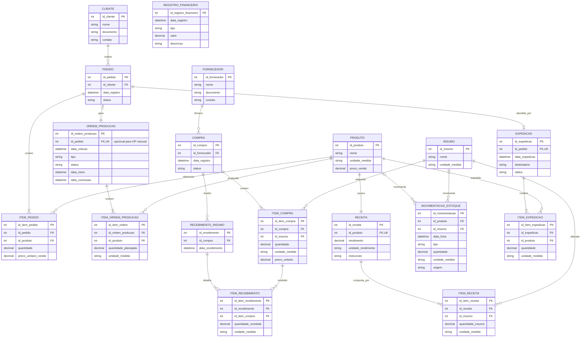

# Diagrama Entidade-Relacionamento (DER)

**Projeto:** Gestão Integrada de Estoque e Produção no Setor Alimentício 
**Revisão:** 10/11/2026 
**Status:** documentação-base com decisões pendentes identificadas 
**Referências:** Diagrama de Classes de Domínio (revisão 24/10/2026), escopo e requisitos, catálogo funcional e decisões confirmadas até 02/11/2026.

> Este documento descreve a proposta lógica de persistência derivada do modelo de domínio. Não define ainda o SGBD, os tipos físicos finais, a estratégia de concorrência ou a implementação. As estruturas adicionais propostas para suportar regras específicas estão identificadas como propostas e devem ser validadas pelo grupo antes de serem consideradas definitivas.

## 0. Diagrama lógico (versão para revisão)

O código-fonte editável em Mermaid está em [`der-gestao-integrada.mmd`](der-gestao-integrada.mmd). O diagrama abaixo é renderizado diretamente pelo GitHub. PD12 permanece pendente; reservas de produtos acabados não integram este modelo.

> **Atenção:** modelo para revisão. PD12, representação física da composição preservada da receita, usuários/perfis e concorrência continuam pendentes de detalhamento.

## 1. Objetivo e escopo

O DER traduz os conceitos do domínio para uma estrutura relacional capaz de armazenar e relacionar dados de:

- clientes, pedidos e itens de pedido;
- produtos, receitas, insumos e composição das receitas;
- ordens de produção e seus itens;
- fornecedores, compras, itens comprados e recebimentos;
- movimentações de estoque de insumos e produtos acabados;
- expedições e seus itens;
- registros financeiros básicos.

A modelagem preserva as regras já consolidadas no projeto. Não inclui funcionalidades fora do escopo, como validade/FEFO, contas a pagar e a receber, contabilidade completa, produção parcial, expedição parcial, roteirização ou gestão de frota.

## 2. PD12 — decisão pendente

A consulta ao estoque de produtos acabados antes do dimensionamento e seu efeito nas quantidades permanecem pendentes. A afirmação de aprovação em 02/11/2026 foi retirada por não corresponder à base consolidada e ao contexto fornecido pelo solicitante. Não se presume reserva de acabados, fórmula de abatimento ou OP com quantidade zero.

Todo pedido continua gerando automaticamente uma única OP; a decisão futura deve preservar essa regra.

## 3. Entidades do domínio e atributos

A lista abaixo parte das classes presentes no Diagrama de Classes oficial. Os nomes físicos das colunas são sugestões em `snake_case`; podem ser ajustados sem alterar o significado do modelo.

Legenda: **PK** = chave primária; **FK** = chave estrangeira; **UQ** = restrição de unicidade; **NULL** = valor opcional; **XOR** = exatamente uma referência deve estar preenchida.

| Entidade | Atributos principais / referências |
|---|---|
| **Cliente** | `id_cliente` (PK), `nome`, `documento`, `contato` |
| **Pedido** | `id_pedido` (PK), `id_cliente` (FK), `data_registro`, `status` |
| **ItemPedido** | `id_item_pedido` (PK), `id_pedido` (FK), `id_produto` (FK), `quantidade`, `preco_unitario_venda` |
| **Produto** | `id_produto` (PK), `nome`, `unidade_medida`, `preco_venda`; `estoque_atual` é derivado |
| **Receita** | `id_receita` (PK), `id_produto` (FK, UQ), `rendimento`, `unidade_rendimento`, `instrucoes` |
| **ItemReceita** | `id_item_receita` (PK), `id_receita` (FK), `id_insumo` (FK), `quantidade_insumo`, `unidade_medida` |
| **Insumo** | `id_insumo` (PK), `nome`, `unidade_medida`; `estoque_atual` é derivado |
| **OrdemProducao** | `id_ordem_producao` (PK), `id_pedido` (FK, UQ, NULL), `data_criacao`, `tipo`, `status`, `data_inicio`, `data_conclusao` |
| **ItemOrdemProducao** | `id_item_ordem` (PK), `id_ordem_producao` (FK), `id_produto` (FK), `quantidade_planejada`, `unidade_medida`; deve preservar a composição, quantidades, unidades e rendimento utilizados (RF35/RN27) |
| **Fornecedor** | `id_fornecedor` (PK), `nome`, `documento`, `contato` |
| **Compra** | `id_compra` (PK), `id_fornecedor` (FK), `data_registro`, `status` |
| **ItemCompra** | `id_item_compra` (PK), `id_compra` (FK), `id_insumo` (FK), `quantidade`, `unidade_medida`, `preco_unitario` |
| **RecebimentoInsumo** | `id_recebimento` (PK), `id_compra` (FK), `data_recebimento` |
| **ItemRecebimento** | `id_item_recebimento` (PK), `id_recebimento` (FK), `id_item_compra` (FK), `quantidade_recebida`, `unidade_medida` |
| **MovimentacaoEstoque** | `id_movimentacao` (PK), `id_produto` (FK, XOR, NULL), `id_insumo` (FK, XOR, NULL), `data_hora`, `tipo`, `quantidade`, `unidade_medida`, `origem` |
| **Expedicao** | `id_expedicao` (PK), `id_pedido` (FK, UQ), `data_expedicao`, `destinatario`, `status` |
| **ItemExpedicao** | `id_item_expedicao` (PK), `id_expedicao` (FK), `id_produto` (FK), `quantidade`, `unidade_medida` |
| **RegistroFinanceiro** | `id_registro_financeiro` (PK), `data_registro`, `tipo`, `valor`, `descricao` |

**Observação sobre os identificadores:** o Diagrama de Classes utiliza o atributo genérico `id` nas classes que possuem identificador. Os nomes específicos (`id_pedido`, `id_produto` etc.) acima são convenções sugeridas para evitar ambiguidades no modelo relacional.

## 4. Relacionamentos e cardinalidades

As cardinalidades abaixo seguem as multiplicidades documentadas no Diagrama de Classes. A implementação relacional utiliza FKs; algumas regras de participação obrigatória precisam de validação transacional ou restrições adicionais, pois uma FK isolada não garante a existência do registro correspondente no outro lado.

| Relacionamento | Cardinalidade | Implementação lógica |
|---|---|---|
| Cliente — Pedido | Cliente 1 : Pedido 0..N | `Pedido.id_cliente` |
| Pedido — ItemPedido | Pedido 1 : ItemPedido 1..N | `ItemPedido.id_pedido` |
| Produto — ItemPedido | Produto 1 : ItemPedido 0..N | `ItemPedido.id_produto` |
| Pedido — OrdemProducao | Pedido 1 : OP 1; OP manual pode ter 0..1 pedido | `OrdemProducao.id_pedido` FK única e opcional |
| OrdemProducao — ItemOrdemProducao | OP 1 : itens 1..N | `ItemOrdemProducao.id_ordem_producao` |
| Produto — ItemOrdemProducao | Produto 1 : itens de OP 0..N | `ItemOrdemProducao.id_produto` |
| Produto — Receita | Produto 1 : Receita 1 | `Receita.id_produto` FK única |
| Receita — ItemReceita | Receita 1 : componentes 1..N | `ItemReceita.id_receita` |
| Insumo — ItemReceita | Insumo 1 : usos 0..N | `ItemReceita.id_insumo` |
| Fornecedor — Compra | Fornecedor 1 : Compra 0..N | `Compra.id_fornecedor` |
| Compra — ItemCompra | Compra 1 : itens 1..N | `ItemCompra.id_compra` |
| Insumo — ItemCompra | Insumo 1 : itens comprados 0..N | `ItemCompra.id_insumo` |
| Compra — RecebimentoInsumo | Compra 1 : recebimentos 0..N | `RecebimentoInsumo.id_compra` |
| RecebimentoInsumo — ItemRecebimento | Recebimento 1 : itens 1..N | `ItemRecebimento.id_recebimento` |
| ItemCompra — ItemRecebimento | Item comprado 1 : recebimentos 0..N | `ItemRecebimento.id_item_compra` |
| Produto — MovimentacaoEstoque | Produto 0..1 por movimentação; produto pode ter 0..N movimentações | FK opcional `MovimentacaoEstoque.id_produto` |
| Insumo — MovimentacaoEstoque | Insumo 0..1 por movimentação; insumo pode ter 0..N movimentações | FK opcional `MovimentacaoEstoque.id_insumo` |
| Pedido — Expedicao | Pedido 1 : Expedição 0..1 | `Expedicao.id_pedido` FK única |
| Expedicao — ItemExpedicao | Expedição 1 : itens 1..N | `ItemExpedicao.id_expedicao` |
| Produto — ItemExpedicao | Produto 1 : itens expedidos 0..N | `ItemExpedicao.id_produto` |

## 5. Regras de integridade e negócio refletidas no DER

### 5.1 Pedidos e ordens de produção

- Todo pedido gera automaticamente uma única OP no registro (RF13/RN10).
- A OP pode ser manual e, nesse caso, não possui pedido de origem (RF11/RN09).
- A OP do pedido contém todos os produtos solicitados; o efeito do saldo de produtos acabados no dimensionamento permanece em PD12.
- A quantidade original solicitada permanece em `ItemPedido`; a quantidade planejada para fabricar é registrada em `ItemOrdemProducao`.
- O pedido pode ser alterado antes do início da produção; a OP e as necessidades devem ser recalculadas conforme as regras vigentes.
- Produção parcial não faz parte da primeira versão.

### 5.2 Receitas e composição preservada

- Cada produto possui uma receita de referência, com rendimento e um ou mais insumos (RN01/RN02).
- Cada item de receita identifica um insumo, sua quantidade e unidade de medida.
- Cada `ItemOrdemProducao` deve preservar a composição, as quantidades, as unidades e o rendimento utilizados no dimensionamento (RF35/RN27).
- A forma física de armazenar essa cópia/snapshot da composição ainda deve ser detalhada. O DER não deve presumir versionamento completo do cadastro de receitas.

### 5.3 Compras e recebimentos

- Registrar uma compra não gera entrada no estoque.
- Somente o recebimento efetivo gera a movimentação de entrada do insumo.
- Uma compra admite vários recebimentos (RF36/RN28).
- Cada `ItemRecebimento` referencia um `ItemCompra` pertencente à mesma compra do recebimento.
- A soma das quantidades recebidas de um item não pode exceder a quantidade comprada.

### 5.4 Estoque e movimentações

- Produto e Insumo mantêm históricos de movimentação distintos.
- Cada `MovimentacaoEstoque` referencia exatamente um Produto ou um Insumo: nunca ambos ou nenhum (restrição XOR).
- `estoque_atual` é um saldo derivado das movimentações em unidade compatível; não deve ser tratado como uma segunda fonte independente de verdade.
- No fluxo normal, o início da produção reserva insumos; a conclusão registra o consumo dos insumos e a entrada dos produtos acabados (RF34/RN26).
- A reserva de insumos não é baixa física. O saldo disponível considera o saldo físico menos as reservas ativas.
- Os detalhes de persistência e concorrência das reservas de insumos permanecem vinculados à pendência PD10.

### 5.5 Expedição

- A expedição está vinculada a um pedido.
- Um pedido pode ter no máximo uma expedição na primeira versão.
- A expedição registra todos os produtos e quantidades do pedido integralmente (RN19).
- A saída física dos produtos acabados ocorre no registro da expedição.
- Produtos acabados passam pelo estoque antes da expedição.

### 5.6 Financeiro

- `RegistroFinanceiro` armazena somente valores básicos das operações.
- Não representa confirmação bancária, contas a pagar/receber ou contabilidade.
- Os vínculos e eventos automáticos dos registros financeiros permanecem pendentes (PD05).
- O custo utiliza a receita e o último preço de compra conhecido dos insumos, considerando rendimento e unidades compatíveis. Preço de venda é cadastrado manualmente.

## 6. Restrições técnicas a implementar no banco

As seguintes regras deverão ser garantidas por constraints, transações, validações ou mecanismos equivalentes no SGBD escolhido:

1. `MovimentacaoEstoque`: exatamente uma entre `id_produto` e `id_insumo` deve estar preenchida (XOR).
2. `Receita.id_produto`: unicidade para garantir uma receita de referência por produto.
3. `OrdemProducao.id_pedido`: unicidade e nulabilidade para permitir OP manual e impedir duas OPs vinculadas ao mesmo pedido.
4. `Expedicao.id_pedido`: unicidade para impedir mais de uma expedição por pedido na primeira versão.
5. `ItemRecebimento`: garantir que o item comprado pertença à mesma compra referenciada pelo recebimento e que o total recebido não exceda o comprado.
6. Na conclusão integral, confirmar conjuntamente a baixa dos insumos, o encerramento das reservas e a entrada de acabados; nenhuma parte deve persistir isoladamente.
7. Quantidades, rendimentos e valores monetários devem respeitar domínios e precisões adequadas; não devem aceitar valores negativos.
8. A obrigatoriedade de toda OP de pedido e a presença de ao menos um item em pedidos, ordens, receitas, compras, recebimentos e expedições devem ser garantidas no fluxo transacional e/ou por mecanismos do SGBD.

## 7. Elementos que não devem ser inventados nesta versão

- Tabelas de usuário/perfil/permissão: a matriz de permissões continua pendente (PD06); não foi detalhada no Diagrama de Classes.
- Relações e eventos automáticos de `RegistroFinanceiro`: pendentes (PD05).
- Versionamento completo de receitas: ainda não definido.
- Estrutura física para snapshot da composição de receita na OP: o requisito está definido, mas a representação técnica precisa ser validada.
- Estrutura técnica de reservas de insumos e controle de concorrência: pendente de arquitetura (PD10).
- Tipos físicos de colunas, índices, estratégias de exclusão e SGBD: não definidos nesta etapa.

## 8. Pontos que precisam ser alinhados antes da aprovação

1. **PD12:** decidir o efeito do estoque acabado no dimensionamento; classes e DER mantêm a mesma pendência.
2. **Snapshot da receita (RF35/RN27):** validar como a composição, quantidades, unidades e rendimento utilizados serão persistidos por item da OP, sem transformar automaticamente isso em versionamento do cadastro da receita.
3. **Concorrência:** definir o mecanismo das reservas de insumos e da conclusão atômica (PD10).
4. **Recebimentos parciais:** validar a integridade entre recebimento, item recebido e item comprado, inclusive o limite acumulado da quantidade recebida.
5. **Financeiro e permissões:** manter o modelo limitado às decisões existentes até que PD05 e PD06 sejam resolvidas.

## 9. Rastreabilidade

| Área | Requisitos e regras relacionados |
|---|---|
| Cadastros, produtos, insumos e receitas | RF01–RF05; RN01–RN02 |
| Pedidos e ordens de produção | RF11–RF18, RF25–RF29; RN09–RN10, RN13, RN16–RN17, RN20–RN21 |
| Reservas e composição da OP | RF34–RF35; RN26–RN27; PD10 e PD12 |
| Compras e recebimentos | RF09–RF10, RF24, RF27, RF36; RN06, RN14–RN15, RN28 |
| Estoques e expedição | RF06–RF08, RF19–RF22; RN07–RN08, RN11, RN18–RN19 |
| Custos, preços e financeiro | RF23–RF24, RF30–RF31, RF33; RN22–RN23, RN25; PD05 e PD11 |

## 10. Histórico da revisão

- **02/11/2026:** documentação-base recebida para revisão.
- **10/11/2026:** corrigidas cardinalidades Pedido–OP, sincronizadas as duas fontes Mermaid e restabelecida PD12 como pendente; conclusão deve confirmar baixa e entrada conjuntamente.

### Limites de acesso e cancelamento

Clientes e fornecedores são cadastros sem acesso. Usuários internos podem acumular Administrador, Comercial, PCP, Compras, Estoque, Produção, Expedição e Financeiro. A matriz de permissões e as tabelas de acesso não são definidas por este DER.

O detalhamento de cancelamento, WIP, perdas e insumos já usados depende do grupo. RN29 na base registra diretrizes anteriores, mas não constitui autorização para completar as transições ou o tratamento operacional nesta revisão. Ausência de último preço de compra permanece pendente em PD11.
