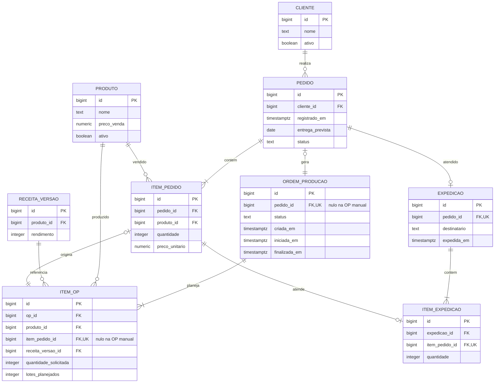
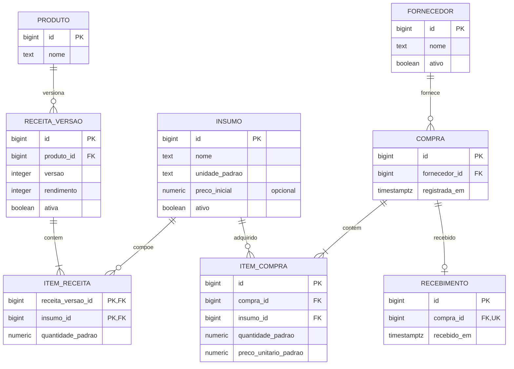
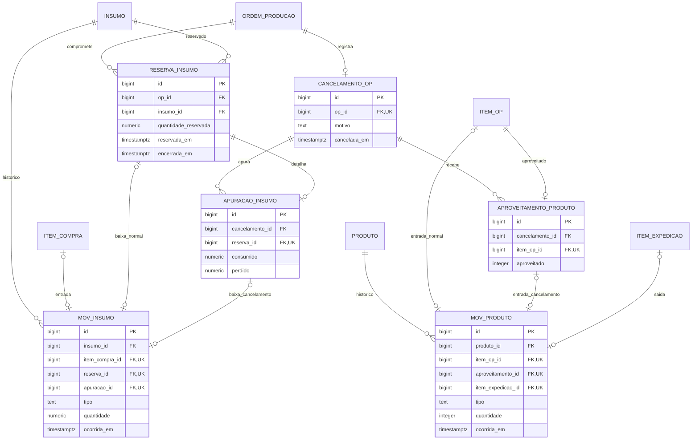
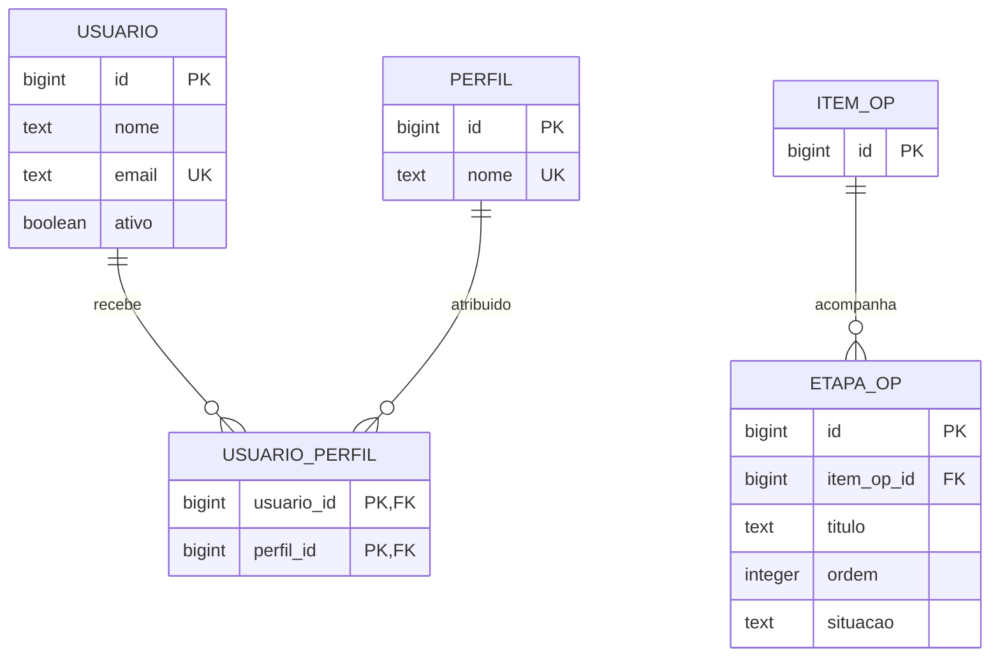

# DER — Gestão Integrada de Estoque e Produção

**Revisão:** 15/11/2026 · **Status:** modelo lógico concluído para revisão do orientador.
**Banco escolhido:** PostgreSQL ([DT01](../../04-arquitetura/decisoes-tecnologicas.md)). Nenhum banco foi criado.

As quatro vistas representam um único modelo. A [fonte completa](der-gestao-integrada.mmd) mantém o endereço editável anterior; as fontes por vista e os blocos abaixo têm o mesmo conteúdo. Abra a [visualização local](der.html) para apresentar, ou edite os blocos Mermaid abaixo. PK = chave primária; FK = chave estrangeira; UK = unicidade. As cardinalidades descrevem registros válidos, inclusive onde uma FK, sozinha, não garante a regra.

## 1. Pedidos, produção e expedição

[Fonte editável da vista 1](der-pedidos-producao-expedicao.mmd) · [SVG exportado](der-pedidos-producao-expedicao.svg)

O pedido e sua única OP nascem na mesma transação. Cada item de pedido tem exatamente um item na OP correspondente; na OP manual o vínculo fica nulo. Alterações antes do início preservam essa correspondência. Por item, lotes = teto(quantidade solicitada ÷ rendimento); quantidade planejada = lotes × rendimento. Pedido de 15 com rendimento de 10 gera 20 unidades: entram 20 e a expedição integral retira 15. Se o rendimento for 1, não há excedente por arredondamento. A OP manual usa o mesmo cálculo. O modelo não reduz a produção por saldo acabado até a decisão PD12.

A expedição exige OP concluída e saldo disponível suficiente, com todos os itens e as quantidades do pedido. Chaves compostas ou validação transacional devem impedir vínculos entre pedidos diferentes. O preço de venda do item é histórico; alterar o cadastro não muda pedidos anteriores.

## 2. Receitas, compras e recebimento

[Fonte editável da vista 2](der-receitas-compras-recebimento.mmd) · [SVG exportado](der-receitas-compras-recebimento.svg)

Uma compra tem zero ou um recebimento, sempre integral. Os itens recebidos são os itens da compra; não há tabela de recebimentos parciais. Confirmar recebimento cria as entradas e congela os itens da compra na mesma transação. Um insumo por compra é uma simplificação proposta no DER, ainda não aprovada. A demonstração preserva compras com vários insumos distintos e impõe provisoriamente no máximo um item por insumo. Isso evita dois preços para o mesmo insumo no mesmo recebimento, sem restringir a compra a um único insumo; a política permanece para validação.

Há no máximo uma receita ativa por produto; um produto liberado para produzir deve ter exatamente uma. Versões publicadas têm composição e rendimento imutáveis; editar cria outra versão. OP não iniciada é recalculada com a nova versão; ao iniciar, congela-se a referência usada. O modelo guarda quantidades e preços na unidade padrão do insumo, aceitando conversões simples entre unidades compatíveis. Mudanças na unidade padrão de insumo com histórico exigem política de migração, ainda a validar.

O preço de referência vem do item da compra recebida mais recentemente, pela data/hora do recebimento; em empate, propõe-se o ID do recebimento. Sem recebimento, usa-se o preço inicial se informado. Sem nenhum preço, o custo é indisponível. Custo unitário = soma dos custos dos insumos de uma receita ÷ rendimento.

## 3. Reservas, cancelamento e movimentações

[Fonte editável da vista 3](der-reservas-cancelamento-movimentos.mmd) · [SVG exportado](der-reservas-cancelamento-movimentos.svg)

As entidades de referência sem atributos nesta vista são as mesmas das vistas anteriores. A classe de domínio MovimentacaoEstoque é desdobrada em duas tabelas lógicas para manter FKs de produto e insumo distintas. Cada movimento operacional tem exatamente uma origem correspondente ao tipo, com FKs alternativas nulas; saldo inicial pode ser lançado separadamente como evento identificado, sujeito à política a validar. Quantidades de movimentos são positivas; o tipo determina o sinal.

- **Início:** somar necessidades por insumo, conferir disponível e gravar uma reserva por par OP/insumo. Saldo disponível = saldo físico − reservas abertas. Na implementação futura, verificação e reserva deverão ser atômicas, com concorrência controlada no PostgreSQL. O frontend simula reserva virtual em uma aba.
- **Conclusão:** encerrar reservas, registrar baixas e entradas integrais, atualizar situação da OP, tudo na mesma transação. As origens únicas evitam duplicar movimentos.
- **Cancelamento após início:** apurar cada reserva (inclusive consumo/perda zero), registrar produtos aproveitáveis quando houver, baixar consumo e perdas sem sobreposição e liberar o restante. Apuração e aproveitamento devem pertencer à mesma OP. Como política inicial a validar, consumo + perdas não ultrapassa o reservado, e aproveitamento não excede o planejado; divergências não devem ser truncadas silenciosamente.
- **Recebimento:** entrada por item da compra somente após confirmação do seu recebimento. **Expedição:** saída por item expedido após conferência integral.

O histórico é a referência para saldo físico; eventual saldo materializado será uma escolha de implementação. Proibir movimentos fora da transação da operação de origem e validar não negatividade de saldos conforme a política aprovada.

## 4. Acesso e acompanhamento

[Fonte editável da vista 4](der-acesso-acompanhamento.mmd) · [SVG exportado](der-acesso-acompanhamento.svg)

Usuários internos acumulam perfis. Clientes e fornecedores não têm acesso. Matriz de permissões e autenticação são decisões futuras. EtapaOP é extensão proposta, baseada no protótipo: o kanban acompanha trabalho por item da OP e não gera movimentação de estoque. Validar se todas as etapas devem ser concluídas como pré-condição da OP definitiva. O financeiro permanece provisório: valores de compra, pedido e expedição podem ser consultados nas respectivas entidades; não se presume tabela definitiva de lançamentos, pagamentos ou estornos.

## Validação e alinhamentos

| Ponto | O que mostrar ou confirmar |
|---|---|
| Classes × recebimentos | RF36/RN28 e classes alinhados ao recebimento único integral em 15/11/2026. |
| Receita e lotes | Uma ativa por produto; OP pendente acompanha revisão; iniciada conserva versão. Lotes inteiros também em OP manual; sobra no estoque. |
| Estoque e cancelamento | Reserva no início; conclusão integral; cancelamento apura consumo, perdas e aproveitamento. Confirmar divergências acima do reservado e ajustes de saldo inicial. |
| Preço e unidades | Último preço **recebido**, com preço inicial opcional. Confirmar critério de empate e alteração de unidade com histórico. |
| Pendências de escopo | Estoque acabado no dimensionamento (PD12), estados, permissões, financeiro e obrigatoriedade das etapas do kanban. |
| Protótipo × DER | Esses refinamentos foram conferidos no checkout local; a integração do frontend correspondente à main continua pendente. Esta branch publica somente modelos e documentação. Restrições relacionais, segurança, transações e concorrência dependem do backend futuro; não há banco criado. |
| Base de demonstração | Padaria/confeitaria sintética proposta; confirmar composição e cenários com o orientador. |

**Próxima etapa:** validar o modelo com o orientador, harmonizar a documentação e detalhar restrições e tipos no esquema físico PostgreSQL. Este DER não é um script de implantação.

## Extensão de reposição — 20/11/2026

O [modelo complementar](reposicao.md), com [fonte](reposicao-dados.mmd) e [SVG](reposicao-dados.svg), propõe dados de configuração, série de consumo e resultados para RF37–RF42. As quatro vistas acima continuam a base do fluxo operacional; a extensão distingue proposta estatística e implementação futura.
