# Extensão lógica para histórico e reposição

Revisão: **20/11/2026**. Proposta para RF37–RF42, ainda sem banco ou implementação. Complementa as quatro vistas do [DER principal](README.md) e não altera relações de compra, pedido, reserva ou produção. [Fonte Mermaid](reposicao-dados.mmd) e [SVG](reposicao-dados.svg).

## Relações e preservação

- Um insumo pode ter várias configurações versionadas e várias séries; cada configuração/série pertence a exatamente um insumo. A falta de série permite representar insumo sem histórico.
- Uma série publicada contém um ou mais períodos, com unicidade de série e início do período. A marca de observação distingue zero de ausência. Periodicidade e calendário ainda dependem de PD14; o campo de data é uma proposta para a agregação diária inicial.
- Cada cálculo utiliza exatamente uma configuração e uma série do **mesmo insumo**, com unidades, cobertura e períodos compatíveis. Vínculos cruzados são inválidos; FKs isoladas não garantem essa regra, que deverá ser validada por restrições compostas e/ou pela transação.
- Configuração e série utilizadas tornam-se imutáveis para permitir reproduzir resultados. Correção cria nova versão, sem sobrescrever a base de um cálculo anterior.
- Situação registra cálculo válido, dados insuficientes ou incompatibilidade. Valores numéricos de resultados indisponíveis não recebem zero artificial. A implementação definirá campos nulos e restrições condicionais no esquema físico.
- Origem/versão deve permitir reconstruir a seleção de eventos e sua regra de agregação. Não transformar automaticamente todas as saídas ou compras em consumo do ingrediente.

O desenho não define uma fórmula final para a posição de alerta, quantidade a comprar ou estoque-alvo. Uma entidade de alerta e seu ciclo de vida dependerão de PD13. Parâmetros de calendário, elegibilidade do histórico e estimador precisam ser congelados no protocolo. Consistência, rastreabilidade e reprodução são verificadas por E01–E05 e RNF06/RNF07/RNF12.

O [catálogo complementar](../../02-requisitos/reposicao-estatistica.md) é a referência funcional. A imagem representa estrutura de dados proposta, não resultados estatísticos nem migração executada.
