# Diagramas de estados — Gestão Integrada

Revisão: **15/11/2026**. Elaboração e alinhamento documental concluídos conforme as decisões confirmadas. Visualizações SVG exportadas e fontes Mermaid editáveis abaixo. Isso não significa aprovação externa, catálogo completo de estados ou backend implementado.

Quatro ciclos operacionais. Os nomes dos estados e transições adicionais permanecem propostas; PD02/PD04/PD08 não são aprovadas pelo desenho.

## Compra recebimento

[Editar Mermaid](estado-compra-recebimento.mmd) · [Abrir SVG](estado-compra-recebimento.svg)

## Ordem producao

[Editar Mermaid](estado-ordem-producao.mmd) · [Abrir SVG](estado-ordem-producao.svg)

## Pedido

[Editar Mermaid](estado-pedido.mmd) · [Abrir SVG](estado-pedido.svg)

## Expedicao

[Editar Mermaid](estado-expedicao.mmd) · [Abrir SVG](estado-expedicao.svg)

## Regras e limites

- Lotes = teto(solicitada / rendimento); planejada = lotes × rendimento, também na OP manual. Insumos por lotes inteiros; expedição atende só o pedido e mantém excedentes.
- Uma OP automática por pedido; PD12 permanece aberta. Não se presume abatimento do estoque acabado.
- Recebimento único integral: registrar compra não altera estoque nem preço. Confirmação gera todas as entradas e referência pela data/hora do recebimento; sem recebimento usa inicial opcional; sem preço, custo indisponível. Desempate por maior ID é provisório.
- Receita publicada imutável; alterar cria versão nova, no máximo uma ativa por produto. OP não iniciada recalcula; iniciada conserva versão e necessidades.
- Cancelamento exige motivo, apuração de cada insumo reservado e aproveitamento da mesma OP; baixa consumo e perdas separados uma única vez, libera reserva restante e recebe aproveitáveis. Limites provisórios do DER: soma até reservado e aproveitamento até planejado; rejeitar divergências sem truncar. Não é conclusão parcial normal ou expedição parcial.
- Segurança, concorrência e transações dependem da implementação futura. Frontend é protótipo acadêmico local. Não se introduzem WIP formal, devoluções ou estornos.

Rastreabilidade: RF09–RF29, RF34–RF36; RN02–RN21, RN26–RN29. Ver [requisitos](../../02-requisitos/escopo-e-requisitos.md), [DER](../dados/README.md) e [auditoria](../../planejamento/auditoria-github-2026-11-15.md).
