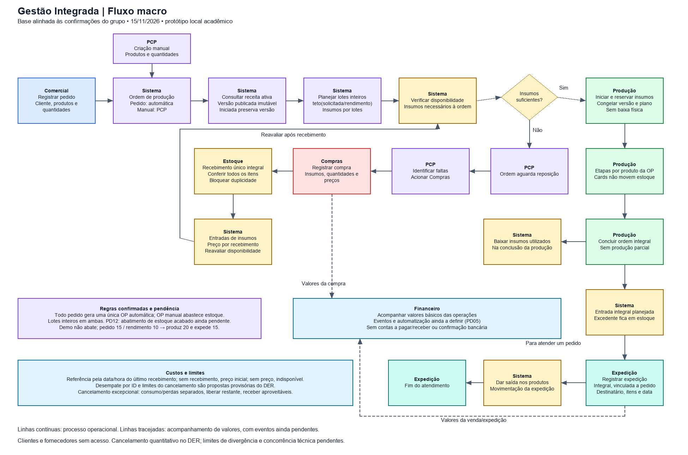

# Fluxo Macro do Sistema

**Revisão:** 17/10/2026 
**Status:** Base consolidada; revisão do grupo sobre o PR #13 confirmada pelo solicitante em 17/10/2026. Detalhamentos pendentes continuam identificados abaixo.

- [Arquivo editável no diagrams.net/draw.io](fluxo-macro.drawio).
- [Imagem para consulta e apresentações](fluxo-macro.png).

## Fluxo representado

1. Comercial registra um pedido com cliente cadastrado, produtos e quantidades.
2. Registrar o pedido gera automaticamente sua única OP. PCP pode criar OP manual, sem pedido. PD12 permanece pendente: a demo não abate saldo acabado.
3. A ordem usa versão da receita e lotes inteiros: teto(solicitada / rendimento). Necessidades são calculadas pelos lotes; quantidade planejada pode exceder a solicitada.
4. O sistema verifica o estoque de insumos. Se houver faltas, a ordem aguarda reposição e PCP aciona Compras.
5. Compras registra a aquisição com quantidades e preços. Esse registro não aumenta o estoque.
6. Estoque confirma o único recebimento integral, registra entradas e atualiza preço de referência pela data/hora; a disponibilidade é reavaliada.
7. Com todos os insumos disponíveis, Produção inicia, executa e conclui integralmente a ordem.
8. A conclusão gera baixa dos insumos e entrada dos produtos acabados no estoque.
9. Expedição registra atendimento integral vinculado ao pedido, com destinatário, produtos, quantidades e data; ocorre a saída correspondente do estoque acabado.

Ordens manuais abastecem o estoque, mas não geram expedição sem pedido. Clientes e fornecedores não acessam o sistema.

## Ajustes em relação ao diagrama enviado

| Ponto | Representação revisada |
|---|---|
| Atendimento | Comercial identificado como responsável pelo pedido. |
| Planejamento | PCP identificado na criação da ordem e no acionamento de Compras. |
| Produtos da ordem | Ordem recebe os itens do pedido ou os produtos/quantidades informados manualmente. |
| Recebimento | Recebimento e entrada atribuídos a Estoque, separados do registro da compra. |
| Reposição | Retorno explícito da entrada de insumos à verificação de disponibilidade. |
| Conclusão | Baixa de insumos e entrada de produtos acabados ligadas à mesma conclusão integral. |
| Expedição | Registro integral vinculado a pedido e saída dos produtos acabados. |
| Financeiro | Valores básicos das operações indicados como acompanhamento; linhas tracejadas não definem eventos automáticos ou pagamentos. |

## Regra confirmada: pedido e estoque acabado

Nesta revisão, o solicitante confirmou que **todo pedido deverá gerar uma ordem de produção**, mesmo quando houver produtos acabados suficientes em estoque. A antiga PD09 está resolvida.

O diagrama mantém o caminho Pedido → Ordem de Produção → Produção → Estoque → Expedição. Não foi incorporado desvio para atendimento direto sem ordem de produção.

A existência de produtos acabados em estoque não dispensa a criação da ordem. Ordens manuais continuam permitidas para abastecimento do estoque.

## Limites e revisão

Produção e expedição parciais, validade/FEFO, contas a pagar/receber e contabilidade completa ficam fora da versão inicial. O desenho representa o caminho principal, não o conjunto completo de estados ou exceções.

Cancelamento quantitativo e reserva no início estão definidos no DER. Limites de divergência, autorizações, concorrência técnica e financeiro continuam pendentes. O caminho principal não representa todas as exceções.

A revisão da base do macrofluxo foi confirmada pelo solicitante em 17/10/2026. Classes e DER deverão utilizar essa base, o [diagrama de casos de uso](../casos-de-uso/README.md) e as pendências documentadas. A regra obrigatória de ordem para todo pedido deve constar nesses modelos. O cronograma e os critérios de revisão estão no [planejamento do TCC1](../../planejamento/revisao-tcc1-2026-10-13.md).

## Alinhamento confirmado pelo grupo — 15/11/2026

Esta revisão prevalece sobre descrições históricas conflitantes. O [DER](../dados/README.md) mantém o modelo de persistência proposto.

- Recebimento único integral: uma compra admite zero ou um recebimento, sempre integral; confirmar gera todas as entradas uma única vez. Registrar a compra não altera estoque nem preço de referência.
- Lotes inteiros, inclusive OP manual: lotes = teto(solicitada / rendimento); planejada = lotes × rendimento; insumos = composição por lote × lotes. Pedido de 15 com rendimento 10 gera entrada de 20 e expedição de 15; excedente de 5 fica em estoque. Uma OP automática por pedido. PD12 (abater estoque acabado) permanece pendente; a demo não abate.
- Versões publicadas da receita têm composição e rendimento imutáveis, com no máximo uma ativa por produto. OP não iniciada acompanha a ativa e recalcula; iniciada preserva versão e quantidades.
- Preço de referência: preço da compra efetivamente recebida mais recentemente, pela data/hora do recebimento; sem recebimento, preço inicial opcional; sem preço, custo indisponível. Desempate pelo maior ID de recebimento é provisório, conforme proposta do DER. Preços históricos dos pedidos são preservados.
- Cancelamento exige motivo e apuração de cada insumo reservado, inclusive zero; consumo exclui perdas. Baixa ambos uma vez, libera a reserva restante e recebe produtos aproveitáveis vinculados à mesma OP. Não admite conclusão parcial normal ou expedição parcial. Limites provisórios: consumo + perdas até reservado; aproveitamento até planejado. Rejeitar divergências sem truncar. Justificativa: evitar saldo negativo ou entrada superior ao plano enquanto a política de exceções aguarda aprovação.
- Kanban acompanha etapas por produto da OP e não movimenta estoque; conclusão integral registra baixas e entradas. Exigir todos os cards concluídos é uma escolha demonstrativa ainda sujeita a validação.
- Frontend local acadêmico, sem backend, API, autenticação real, hospedagem ou PostgreSQL em execução. Reservas virtuais e troca de estado local demonstram regras; garantias de transação, segurança e concorrência multiusuário dependem do futuro backend. PostgreSQL permanece a escolha futura (DT01).

Exportações PNG/JPG regeneráveis a partir do draw.io com `python docs/03-modelagem/render_drawio.py` (Pillow, Arial ou DejaVu Sans).
