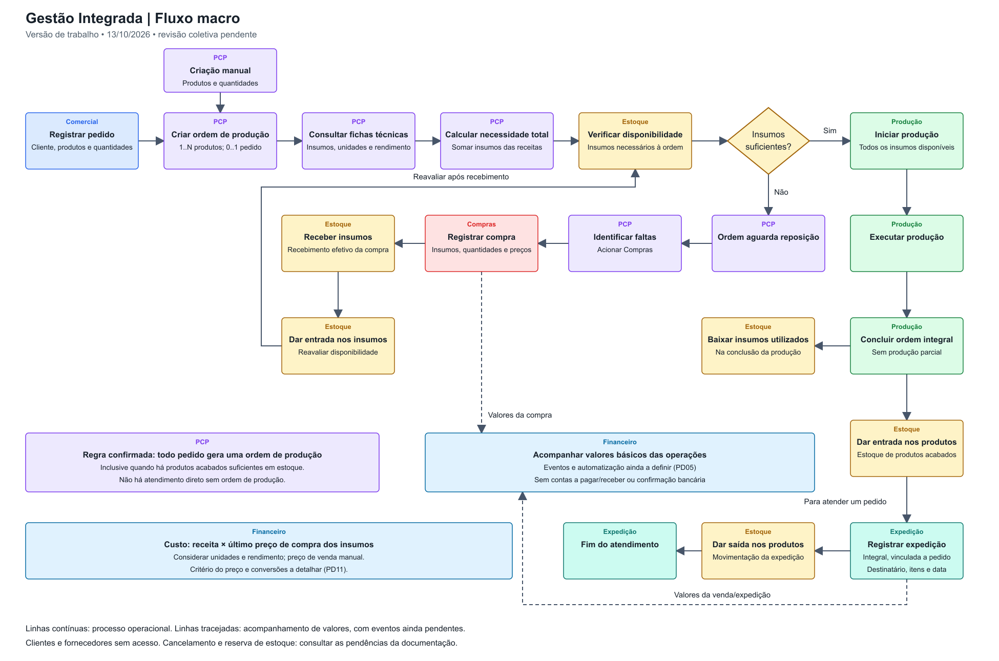

# Fluxo Macro do Sistema

**Revisão:** 13/10/2026 
**Status:** Versão de trabalho baseada no resumo da discussão e no diagrama enviado pelo grupo; aguardando validação coletiva.

- [Arquivo editável no diagrams.net/draw.io](fluxo-macro.drawio).
- [Imagem para consulta e apresentações](fluxo-macro.png).

## Fluxo representado

1. Comercial registra um pedido com cliente cadastrado, produtos e quantidades.
2. PCP cria uma única ordem de produção para esse pedido, mesmo com produtos acabados suficientes em estoque. Também pode criar uma ordem manual com produtos e quantidades, sem pedido.
3. A ordem consulta as fichas técnicas/receitas e calcula a necessidade total de insumos, considerando quantidades e rendimento.
4. O sistema verifica o estoque de insumos. Se houver faltas, a ordem aguarda reposição e PCP aciona Compras.
5. Compras registra a aquisição com quantidades e preços. Esse registro não aumenta o estoque.
6. Estoque registra o recebimento efetivo e a entrada dos insumos; a disponibilidade da ordem é reavaliada.
7. Com todos os insumos disponíveis, Produção inicia, executa e conclui integralmente a ordem.
8. A conclusão gera baixa dos insumos e entrada dos produtos acabados no estoque.
9. Expedição registra atendimento integral vinculado ao pedido, com destinatário, produtos, quantidades e data; ocorre a saída correspondente do estoque acabado.

Ordens manuais abastecem o estoque, mas não geram expedição sem pedido. Clientes e fornecedores não acessam o sistema.

## Ajustes em relação ao diagrama enviado

| Ponto | Representação revisada |
|---|---|
| Atendimento | Comercial identificado como responsável pelo pedido. |
| Planejamento | PCP identificado na criação da ordem e no acionamento de Compras. |
| Produtos da ordem | Ordem recebe os itens do pedido ou os produtos/quantidades informados manualmente. |
| Recebimento | Recebimento e entrada atribuídos a Estoque, separados do registro da compra. |
| Reposição | Retorno explícito da entrada de insumos à verificação de disponibilidade. |
| Conclusão | Baixa de insumos e entrada de produtos acabados ligadas à mesma conclusão integral. |
| Expedição | Registro integral vinculado a pedido e saída dos produtos acabados. |
| Financeiro | Valores básicos das operações indicados como acompanhamento; linhas tracejadas não definem eventos automáticos ou pagamentos. |

## Regra confirmada: pedido e estoque acabado

Nesta revisão, o solicitante confirmou que **todo pedido deverá gerar uma ordem de produção**, mesmo quando houver produtos acabados suficientes em estoque. A antiga PD09 está resolvida.

O diagrama mantém o caminho Pedido → Ordem de Produção → Produção → Estoque → Expedição. Não foi incorporado desvio para atendimento direto sem ordem de produção.

A existência de produtos acabados em estoque não dispensa a criação da ordem. Ordens manuais continuam permitidas para abastecimento do estoque.

## Limites e revisão

Produção e expedição parciais, validade/FEFO, contas a pagar/receber e contabilidade completa ficam fora da versão inicial. O desenho representa o caminho principal, não o conjunto completo de estados ou exceções.

Cancelamento durante produção, reservas/concorrência e detalhes financeiros permanecem pendentes conforme o [escopo](../../02-requisitos/escopo-e-requisitos.md). Motivo e situação de produtos/insumos devem ser registrados no cancelamento; as movimentações dessa exceção serão detalhadas antes de modelá-la.

Aprovar o macrofluxo e revisar a Issue #2 são dependências para consolidar classes e DER. A regra obrigatória de ordem para todo pedido deve constar nesses modelos. O cronograma e os critérios de revisão estão no [planejamento do TCC1](../../planejamento/revisao-tcc1-2026-10-13.md).
