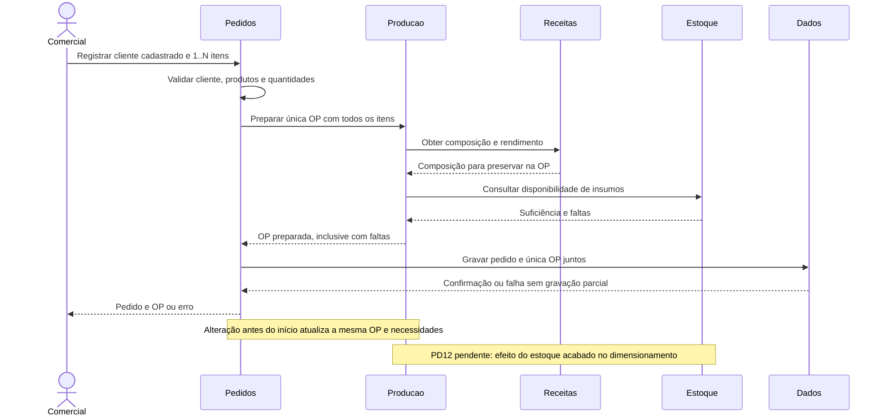
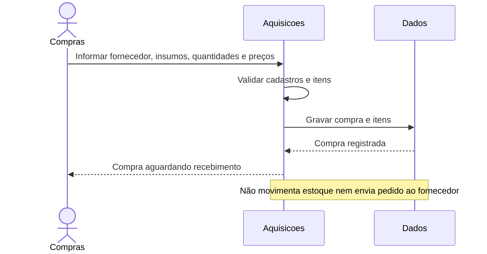
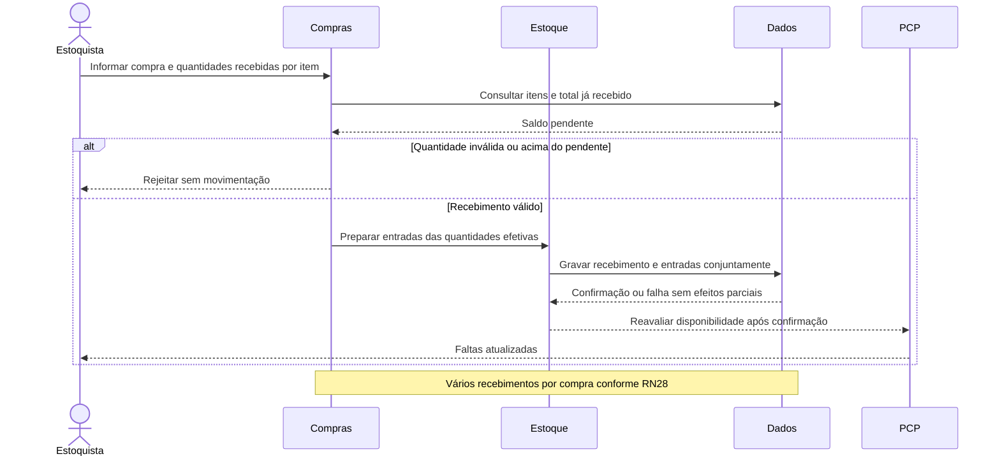
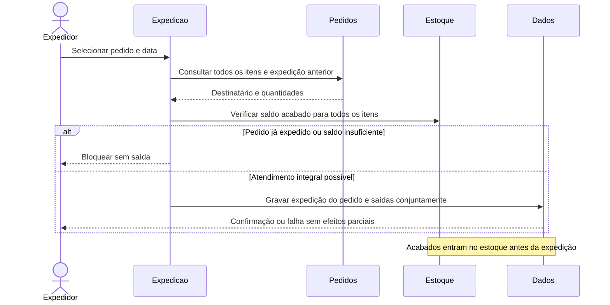

# Sequências dos fluxos principais

Revisão: 10/11/2026. Sequências de análise para a issue #7. Os participantes representam responsabilidades lógicas, não serviços implantados separadamente. As fontes Mermaid abaixo são editáveis e renderizadas pelo GitHub. Operações que gravam dados devem validar usuário interno autorizado; a matriz detalhada permanece em PD06.

## Pedido e criação de OP



OP manual: PCP solicita diretamente a Produção com 1..N produtos, sem pedido; reutiliza cálculo, composição preservada e verificação de faltas. Geração automática integra registrar pedido, sem caso de uso adicional.

## Registro de compra



## Recebimento



## Início e conclusão integral

```mermaid
sequenceDiagram
    actor Operador
    participant Producao
    participant Estoque
    participant Dados
    Operador->>Producao: Iniciar OP
    Producao->>Estoque: Verificar saldo disponível e reservar conjuntamente
    alt Faltam insumos
        Estoque-->>Producao: Faltas
        Producao-->>Operador: Aguardando reposição, início bloqueado
    else Insumos suficientes
        Estoque->>Dados: Confirmar reserva e início juntos
        Dados-->>Producao: OP em produção
        Note over Estoque,Dados: Reserva sem baixa física; concorrência técnica em PD10
        Operador->>Producao: Concluir integralmente
        Producao->>Dados: Validar OP em produção e obter composição preservada
        Dados-->>Producao: Itens e necessidades
        Producao->>Estoque: Preparar baixa única e entrada de todos os acabados
        Estoque->>Dados: Transação: baixa, encerra reservas, entrada e conclusão
        alt Transação confirmada
            Dados-->>Operador: OP concluída e estoques atualizados
        else Falha
            Dados-->>Operador: Operação não confirmada, sem efeitos parciais
        end
    end
    Note over Producao,Dados: Repetir conclusão não pode repetir movimentos
```

## Expedição integral



Rastreabilidade: pedido/OP RF11–RF18 e RF25–RF27; compra/recebimento RF09–RF10 e RF36; início/conclusão RF19–RF20, RF28, RF34–RF35; expedição RF21–RF22. Cancelamento/WIP, PD12, estados completos e evento financeiro não recebem novos comportamentos nestas sequências.
