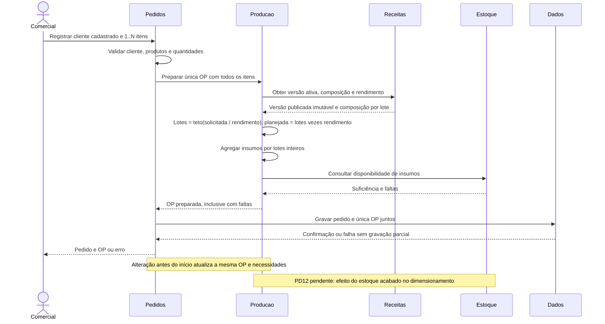
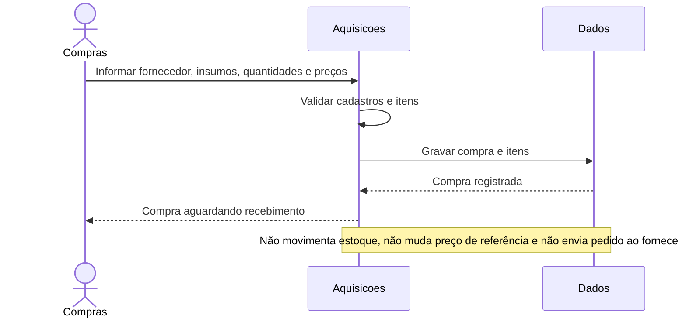
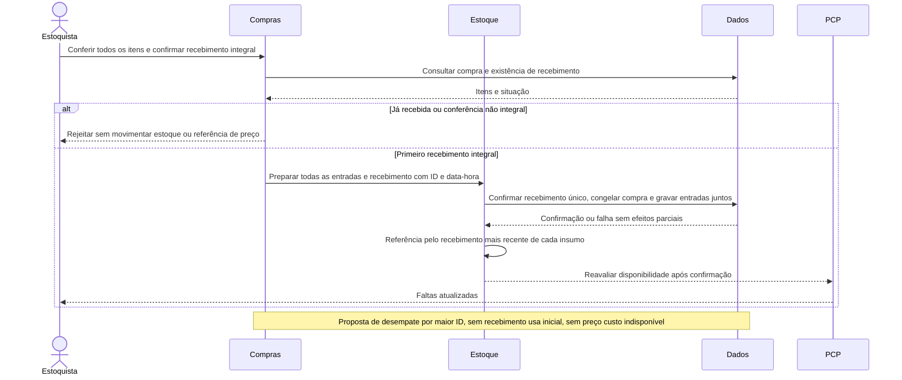
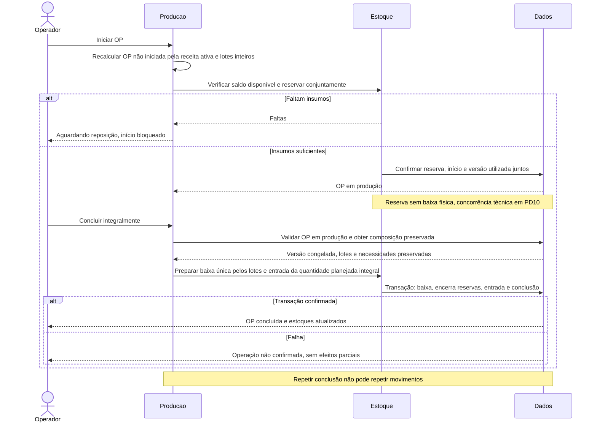
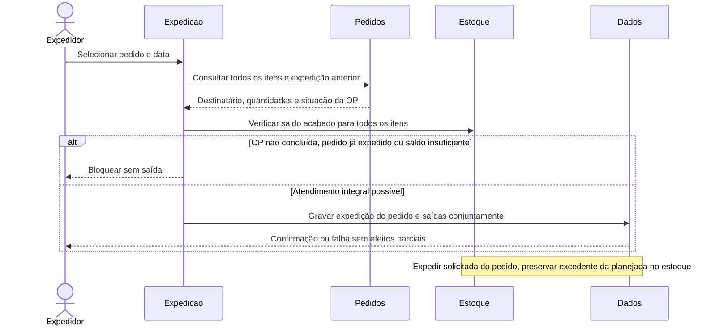
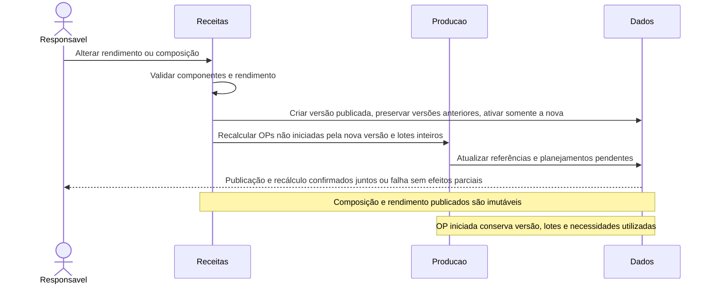
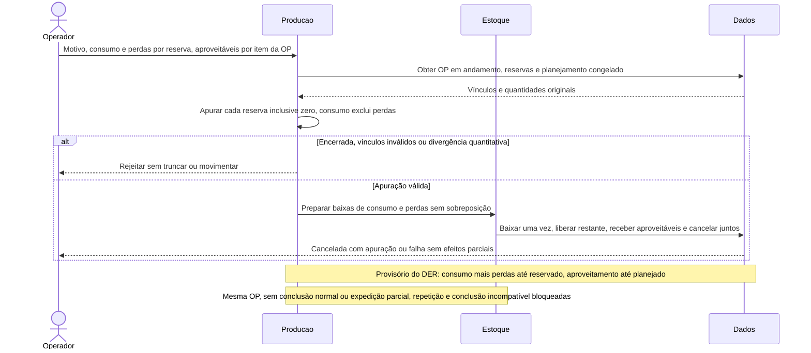

# Sequências dos fluxos principais

Revisão: 15/11/2026. Elaboração documental concluída; participantes e contratos representam o sistema futuro, não serviços já implementados. Sequências de análise para a issue #7. Os participantes representam responsabilidades lógicas, não serviços implantados separadamente. As fontes Mermaid abaixo são editáveis e renderizadas pelo GitHub. Operações que gravam dados devem validar usuário interno autorizado; a matriz detalhada permanece em PD06.

## Pedido e criação de OP

OP manual: PCP solicita diretamente a Produção com 1..N produtos, sem pedido; reutiliza lotes inteiros, versão ativa e verificação de faltas; OP não iniciada acompanha revisões, iniciada preserva versão e plano. Geração automática integra registrar pedido, sem caso de uso adicional.

## Registro de compra

## Recebimento único integral

## Início e conclusão integral

## Expedição integral

Rastreabilidade: pedido/OP RF11–RF18 e RF25–RF27; compra/recebimento RF09–RF10 e RF36; início/conclusão RF19–RF20, RF28, RF34–RF35; expedição RF21–RF22. PD12, catálogo completo de estados, autorizações e eventos financeiros permanecem pendentes. Cancelamento quantitativo e versões seguem as decisões confirmadas abaixo; WIP formal não foi introduzido.

## Publicação de nova receita

## Cancelamento quantitativo

## Fontes e visualizações

As fontes separadas `.mmd` e os SVGs abaixo são gerados dos blocos editáveis deste documento. O [renderizador](../render_mermaid.mjs) verifica a correspondência e exporta as visualizações; manter ambos sincronizados.

- [Fonte: pedido-op](pedido-op.mmd) · [SVG](pedido-op.svg)
- [Fonte: registro-compra](registro-compra.mmd) · [SVG](registro-compra.svg)
- [Fonte: recebimento-integral](recebimento-integral.mmd) · [SVG](recebimento-integral.svg)
- [Fonte: inicio-conclusao](inicio-conclusao.mmd) · [SVG](inicio-conclusao.svg)
- [Fonte: expedicao-integral](expedicao-integral.mmd) · [SVG](expedicao-integral.svg)
- [Fonte: versao-receita](versao-receita.mmd) · [SVG](versao-receita.svg)
- [Fonte: cancelamento-quantitativo](cancelamento-quantitativo.mmd) · [SVG](cancelamento-quantitativo.svg)
