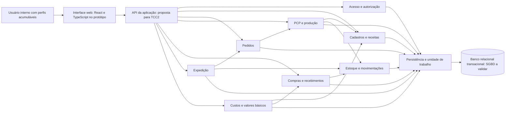

# Arquitetura e componentes

Revisão: 10/11/2026. Projeto técnico inicial para o TCC1 (issue #8). A implementação definitiva e a confirmação das tecnologias de backend e banco ficam para o grupo; esta entrega não afirma que a API já existe.

## Organização

Adotar como proposta um monólito modular: interface web, uma API com módulos de negócio e uma persistência relacional transacional. Esse desenho atende ao porte das PMEs e permite confirmar a conclusão da produção em uma única transação, sem distribuir estoques em serviços independentes.

O protótipo existente usa React, TypeScript e Vite, com dados locais; ele demonstra interações e não substitui banco, autenticação ou autorização reais. Backend e SGBD permanecem escolhas técnicas a validar. A interface não deve ser fonte de autoridade para saldo, permissão ou regra de negócio.

## Componentes

| Componente | Responsabilidade |
|---|---|
| Acesso | Identidade interna e verificação de permissão por ação. Administrador, Comercial, PCP, Compras, Estoque, Produção, Expedição e Financeiro são acumuláveis; matriz em PD06. |
| Cadastros/receitas | Cliente e fornecedor sem login; produtos, insumos, unidades, composição e rendimento. |
| Pedidos | Pedido com 1..N itens e única OP automática; edição antes do início atualiza a mesma OP. |
| PCP/produção | OP manual ou de pedido, necessidades agregadas, faltas, reserva no início e conclusão integral; preservar composição usada. |
| Compras/recebimentos | Compra e preços sem entrada de estoque; recebimentos efetivos por item e limite acumulado. |
| Estoque | Histórico de entradas/saídas, referência exclusiva a insumo ou produto e saldo derivado. |
| Expedição | Atendimento integral de um pedido, com saldo acabado e sem duplicação da saída. |
| Custos/valores | Custo pela receita e último preço de compra, preço de venda manual e valores operacionais; eventos financeiros ainda em PD05. |
| Persistência | Fronteiras transacionais, unicidade, integridade referencial e prevenção de gravações parciais. |

## Integridade exigida e decisões técnicas abertas

- Pedido e OP são gravados juntos, com unicidade da referência ao pedido; OP manual admite referência vazia.
- Início revalida disponibilidade e confirma reserva conjuntamente com a mudança da OP. A solução de concorrência (por exemplo, bloqueio ou controle de versão) será escolhida e testada em PD10.
- Conclusão confirma baixa de insumos, encerramento das reservas, entrada de acabados e estado da OP na mesma transação; falha reverte todos os efeitos.
- Recebimento respeita o saldo de cada item comprado. Expedição é única por pedido e confirma saídas conjuntamente.
- Comandos repetidos não duplicam recebimentos, conclusão ou expedição; a identificação técnica de repetição será detalhada na implementação.
- Valores monetários e quantidades usam precisão decimal adequada; unidades compatíveis e conversões precisam ser definidas antes da implementação.
- Credenciais não ficam no frontend. API valida autenticação, autorização e entradas. Backup, recuperação e critérios mensuráveis de desempenho serão especificados no TCC2.

Não são aprovadas aqui PD12, política de cancelamento/WIP, ausência de último preço, máquina completa de estados ou tabelas físicas de snapshot e reservas. O DER continua lógico. O critério desta entrega é documentar a proposta e os contratos de integridade; validar escolhas com o grupo é uma etapa distinta.
