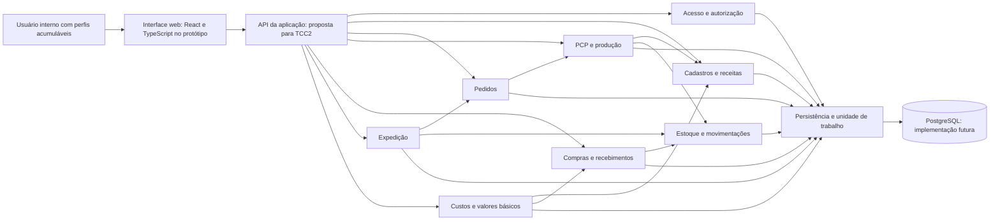

# Arquitetura e componentes

Revisão: 15/11/2026. Projeto técnico inicial para o TCC1 (issue #8). A implementação definitiva e a escolha do backend ficam para o TCC2; PostgreSQL está confirmado como escolha futura (DT01); esta entrega não afirma que a API já existe.

## Organização

Adotar como proposta um monólito modular: interface web, uma API com módulos de negócio e uma persistência relacional transacional. Esse desenho atende ao porte das PMEs e permite confirmar a conclusão da produção em uma única transação, sem distribuir estoques em serviços independentes.

O protótipo existente usa React, TypeScript e Vite, com dados locais; ele demonstra interações e não substitui banco, autenticação ou autorização reais. PostgreSQL é a escolha confirmada da implementação futura; versão, backend, acesso ao banco e hospedagem permanecem a definir. Nesta entrega não há API, autenticação real ou banco em execução. A interface não deve ser fonte de autoridade para saldo, permissão ou regra de negócio.

## Componentes

| Componente | Responsabilidade |
|---|---|
| Acesso | Identidade interna e verificação de permissão por ação. Administrador, Comercial, PCP, Compras, Estoque, Produção, Expedição e Financeiro são acumuláveis; matriz em PD06. |
| Cadastros/receitas | Cliente e fornecedor sem login; produtos, insumos, unidades, versões imutáveis, composição e rendimento; no máximo uma ativa por produto. |
| Pedidos | Pedido com 1..N itens e única OP automática; edição antes do início atualiza a mesma OP. |
| PCP/produção | OP manual ou de pedido, lotes inteiros, necessidades agregadas, reserva no início e conclusão integral; versão atual na pendente e congelada na iniciada; cancelamento quantitativo excepcional. |
| Compras/recebimentos | Compra sem alterar estoque ou referência de preço; único recebimento integral gera todas as entradas e referência pela data-hora. |
| Estoque | Histórico de entradas/saídas, referência exclusiva a insumo ou produto e saldo derivado. |
| Expedição | Atendimento integral de um pedido, com saldo acabado e sem duplicação da saída. |
| Custos/valores | Custo pela receita e preço pelo recebimento mais recente, ou inicial; sem preço custo indisponível; preço de venda manual e valores operacionais; eventos financeiros ainda em PD05. |
| Persistência | Fronteiras transacionais, unicidade, integridade referencial e prevenção de gravações parciais. |

## Integridade exigida e decisões técnicas abertas

- Pedido e OP são gravados juntos, com unicidade da referência ao pedido; OP manual admite referência vazia.
- Início revalida disponibilidade e confirma reserva conjuntamente com a mudança da OP. A solução de concorrência (por exemplo, bloqueio ou controle de versão) será escolhida e testada em PD10.
- Conclusão confirma baixa de insumos, encerramento das reservas, entrada de acabados e estado da OP na mesma transação; falha reverte todos os efeitos.
- Compra tem um único recebimento integral, confirmado com todas as entradas; referência de preço usa data-hora do recebimento mais recente, com preço inicial opcional e custo indisponível na ausência. Expedição é única por pedido e confirma saídas conjuntamente.
- Receita publicada tem rendimento e composição imutáveis. Alteração cria versão, atualiza a ativa e recalcula OPs não iniciadas; iniciadas preservam a utilizada.
- Cancelamento confirma motivo/apuração, consumo e perdas separados, liberação da reserva restante e entrada dos aproveitáveis da mesma OP uma única vez; encerramentos incompatíveis são rejeitados. Limites de divergência do DER são provisórios e não são truncados.
- Comandos repetidos não duplicam recebimentos, conclusão ou expedição; a identificação técnica de repetição será detalhada na implementação.
- Valores monetários e quantidades usam precisão decimal adequada; unidades compatíveis e conversões precisam ser definidas antes da implementação.
- Credenciais não ficam no frontend. API valida autenticação, autorização e entradas. Backup, recuperação e critérios mensuráveis de desempenho serão especificados no TCC2.

Permanecem pendentes PD12, aprovação dos limites de cancelamento e do desempate de recebimentos, WIP formal, catálogo completo de estados, permissões e detalhes físicos/concorrência. Recebimento único, lotes, versões, cancelamento quantitativo e fallback de preço são decisões confirmadas. Proposta de monólito modular não é decisão definitiva de framework ou implantação. O DER continua lógico. O critério desta entrega é documentar a proposta e os contratos de integridade; validar escolhas com o grupo é uma etapa distinta.

## Visualização exportada

[Fonte editável](componentes.mmd) · [SVG](componentes.svg)

