# Fluxo e mapa da modelagem para apresentação

Revisão: **20/11/2026**. Material de preparação, sem substituir os diagramas oficiais. O público deve conhecer o funcionamento geral antes dos detalhes técnicos. A abertura e o contexto anteriores são preservados como base; a avaliação será apresentada como plano de uso do produto e verificação técnica.

## Fluxo de abertura

[Fonte editável](../03-modelagem/fluxo-macro/apresentacao-resumida.mmd). Vista didática do caminho de um pedido. A fala sugerida é:

> A partir de um pedido, o sistema calcula os ingredientes necessários pelas receitas e confere a disponibilidade em estoque. Quando há faltas, indica a necessidade de reposição. Durante a produção, o quadro visual mostra o andamento das etapas até os produtos ficarem prontos para entrega.

Compras, recebimento e reservas estão condensados nessa abertura. Seus eventos e garantias continuam nos requisitos e nos modelos técnicos. A simplificação visual não muda regras de negócio nem transforma atualização de cartão em movimentação física. OP manual é uma entrada alternativa, explicada se necessária, sem envio sem pedido. A confeitaria e a encomenda são cenário ilustrativo até a conversa com o possível contato.

## Mapa dos modelos

| Pergunta | Evidência completa para selecionar na apresentação |
|---|---|
| Como o trabalho percorre o sistema? | [Macrofluxo oficial](../03-modelagem/fluxo-macro/README.md) e vista resumida acima. |
| Quem usa e o que pode fazer? | [Casos de uso](../03-modelagem/casos-de-uso/README.md), [catálogo](../02-requisitos/atores-casos-de-uso-regras-de-negocio.md) e [CU21/CU22 da extensão](../02-requisitos/reposicao-estatistica.md). |
| O que o sistema deve fazer? | RF01–RF36 no [escopo](../02-requisitos/escopo-e-requisitos.md) e RF37–RF43 no [complemento](../02-requisitos/reposicao-estatistica.md). |
| Que critérios de qualidade serão verificados? | [RNF01–RNF13](../02-requisitos/requisitos-nao-funcionais.md), com método e aceite. |
| Quais dados se relacionam? | [DER completo em quatro vistas](../03-modelagem/dados/README.md) e [extensão estatística proposta](../03-modelagem/dados/reposicao.md). |
| Como os conceitos e regras se organizam? | [Classes de domínio](../03-modelagem/classes/README.md). |
| Como os componentes colaboram? | [Arquitetura e componentes](../04-arquitetura/README.md) e [sequências](../03-modelagem/sequencia/README.md). |
| Como isso aparece no produto? | Contextualizar o [protótipo](../05-prototipos/README.md) e suas funções antes de mostrar o Kanban com exemplo curto. |
| Como verificaremos as entregas? | [Matriz RF/RNF e cenários](../06-testes/matriz-rastreabilidade.md), [verificação técnica](../06-testes/metodologia-de-validacao.md) e [avaliação de uso](../06-testes/avaliacao-de-uso.md). |

O mapa é um índice de explicação. Selecionar diagramas completos que continuem legíveis e ampliar as vistas pertinentes do DER, garantindo que o conjunto completo esteja acessível. Não colocar miniaturas de todos os modelos em um slide ilegível para alegar cobertura. A numeração e o tempo dos slides serão fechados na revisão do PowerPoint. Detalhes de revisão ficam no roteiro, sem criar slides de apoio por padrão.

## Contribuição e objetivo em discussão

Foco escolhido: produto e avaliação de uso, tendo como tarefa principal planejar e acompanhar uma encomenda. A política de reposição estatística é complementar. O objetivo proposto é desenvolver e avaliar um sistema integrado, baseado em receitas, para apoiar a otimização dos processos e a melhoria do nível de serviço. Benefícios operacionais dependerão de indicador e referência definidos no protocolo; não estão comprovados.

Manter os conceitos de ES/PR e o exemplo fictício, explicar o nível de serviço por ciclo e contextualizar as funções demonstradas antes do quadro. Na tabela bibliográfica, usar dimensões de comparação que também façam sentido para a linha “Este trabalho”. Não confundir a existência de fórmulas em produtos comerciais com uma novidade própria.
